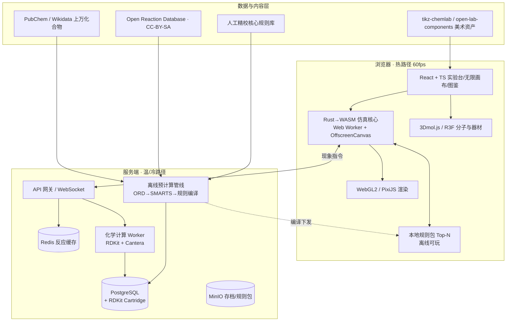

# Open Chem Lab · 开源超自由仿真化学实验室

> **工作代号：Crucible（坩埚）** — 一个专业、好玩、无限制的超自由仿真化学实验室。
> 既能当沙盒游戏玩，也能当各学段化学教具用；**对标并超越同类闭源产品「NB实验室」**。

[](LICENSE)
[](docs/10-完整规划与风险登记册.md)
[](docs/design/07-API契约与部署.md)
[](docs/README.md)

---

## 这是什么

一个**开源、可自建服务器部署**的交互式化学实验室。核心玩法是：任意取用器材与药品、任意混合、参数自由调节，即时看到变色、沉淀、气泡、燃烧、爆炸、结晶、温度与 pH 曲线等现象；**错误操作的后果（密闭加热炸裂、浓硫酸稀释飞溅、钠入水爆炸）可以零风险重现**。既是可探索的化学沙盒，也是覆盖小学科学到高中的教学工具。

**为什么做**：NB实验室（NOBOOK / 北京乐步教育）把这套体验做得很好，但它是闭源商业产品，免费版仅开放约 20% 实验与器材，完整功能需购买个人版/学校版，且无法部署在自己的服务器上。经两轮多引擎 + GitHub 精确检索确认，**不存在可直接部署的开源单体替代品**——整体型虚拟化学实验室（NB、ChemCollective、Model ChemLab、ChemBox）全部闭源。但「零件层」开源生态极其成熟且许可证友好，缺的只是把它们串成一个产品的胶水层与内容层。本项目就是做这件事。

> 目标与不可协商的约束已固化在 [CHARTER.md](CHARTER.md)；改动它必须走 ADR 流程。

## 当前状态：第一阶段 · 规划与设计

本仓库目前**以文档为主**，处于「先详细规划、再准确执行」的规划阶段。已完成：

- 两轮跨源调研（NB 产品功能、全球开源生态、许可证、美术资产链、同类产品工程经验）
- 仓库建立、许可证选型、目标与开发规范固化
- 完整的架构设计、数据模型、美术资产管线、工程路径、风险登记册与分阶段路线图

**尚不包含可运行的产品代码**。这是刻意的：先用文档把技术不确定性、许可证红线、资产来源、数据规模和工程路径全部消解，再动手写代码，避免推倒重来。可运行的验证脚本与骨架代码属于 M0/M1 阶段，见 [路线图](#路线图)。

## 目标特性（规划）

| 能力 | 设计要点 |
|---|---|
| **混合分层仿真** | L0 浏览器 Rust→WASM 粒子引擎（热传导/压强/扩散/相变/流体，60fps、断网可玩）；L1 条件化反应规则；L2 服务端 RDKit + Cantera 异步求解；L3 PostgreSQL + RDKit Cartridge 化合物库 |
| **双视图** | 实验台模式（真实器材逻辑：倾倒/加热/点燃/通电/密封加压/搅拌/过滤）+ 无限画布模式（物质当粒子喷洒） |
| **现象系统** | 变色、气泡、沉淀、结晶、燃烧、爆炸、烟雾、腐蚀、放热、吸热、爆瓶、电极析气；温度/pH/压强/质量四条实时曲线 |
| **错误操作可视化** | 最有价值、也是「看实验视频」永远给不了的部分；夸张、即时、带音效与慢放回放 |
| **上万物质 / 反应** | 分层兑现：可查询化合物（PubChem 资料卡）≠ 可反应物质（需规则覆盖）≠ 表现型粒子（客户端几百种）。不做「万能反应预测」的假承诺，未命中明确返回「当前条件下无明显变化」并记入补规则飞轮 |
| **自由度与元系统** | 自定义物质/器材、规则包导入导出、反应图鉴与发现度、成就闯关、自动实验报告、存档分享、社区工坊 |
| **教具闭环** | 教材同步实验、分步指导与纠错、实验报告、操作测评、教师布置作业、班级与账号（可用 LTI 1.3 / xAPI 对接校园平台） |
| **2D / 3D** | 2D 器材由矢量资产驱动；3D 器材用 Three.js 程序化建模（现成 CC0 化学器材 GLB 稀缺）；分子/晶体用 3Dmol.js / Mol* |
| **一键自托管** | Docker Compose；一个账号多端同步；无会员墙、无云依赖也能玩 |

## 架构速览



## 站在开源巨人的肩上

本项目**坚决不重复造轮子**：仿真引擎、化学信息学、分子可视化、器材组件、图标、数据源全部复用成熟开源项目，自研部分只集中在「规则编排 + 现象映射 + 产品胶水 + 内容精校」。完整清单（含许可证、核实状态、用途）见 [CREDITS.md](CREDITS.md) 与 [开源生态全景与选型](docs/research/02-开源生态全景与选型.md)。

| 层 | 主力开源组件 | 许可证 |
|---|---|---|
| 仿真内核原型 | Sandspiel（Rust/WASM 落沙） | MIT |
| 化学信息学 | RDKit / RDKit.js MinimalLib、Indigo、Kekule.js | BSD-3 / Apache-2 / MIT |
| 数值计算 | Cantera、CoolProp、thermo、PyBaMM | BSD-3 / MIT |
| 数据 | PubChem PUG-REST、Open Reaction Database、ORDerly | 免费公开 / CC-BY-SA-4.0 / MIT |
| 分子可视化 | 3Dmol.js、Mol*、SmilesDrawer | BSD-3 / MIT |
| 前端 | React、Three.js / R3F、PixiJS、Zustand、Yjs、Vite | MIT / ISC |
| 美术资产 | tikz-chemlab、@itkdm/open-lab-components、LabIcons、bioicons、Lucide/Tabler、Kenney | LPPL / MIT / CC-BY / CC0 等（逐项见资产管线） |
| 教学标准 | ltijs (LTI 1.3)、xAPI、H5P | Apache-2 / MIT |

> **许可证红线**：主链只用宽松许可（MIT / BSD / Apache / ISC）；GPL 项目（The Powder Toy、PhET、tptmp）仅作设计参考或独立自托管页面，不 import、不链接、不合并构建产物；CC-BY-SA 数据（ORD）与代码分仓、独立署名。详见 [许可证合规矩阵](docs/design/07-API契约与部署.md) 与 [ADR-0005](docs/adr/ADR-0005-不链接GPL组件与CC-BY-SA数据隔离.md)。

## 文档导航

| 文档 | 内容 |
|---|---|
| [CHARTER.md](CHARTER.md) | **项目宪章**：固定的目标、不可协商约束、开发规范、已确认决策 |
| [CREDITS.md](CREDITS.md) | 完整致谢与逐项许可证 |
| [docs/README.md](docs/README.md) | 文档总索引与阅读顺序 |
| [docs/research/](docs/research/) | 调研：NB 对标分析、开源生态全景、美术资产链 |
| [docs/design/](docs/design/) | 设计：架构、仿真内核与玩法、数据模型与 Schema、美术资产管线、工程结构与路径、教学层、API 与部署 |
| [docs/adr/](docs/adr/) | 架构决策记录（ADR） |
| [docs/10-完整规划与风险登记册.md](docs/10-完整规划与风险登记册.md) | **第一阶段主交付物**：路线图、验收标准、全部预料中的问题与预案 |

## 路线图

| 阶段 | 周期（单人估算） | 交付物 | 验收标准 |
|---|---|---|---|
| **M0 先玩起来 / 验证基座** | 1–2 天 | 部署现成开源项目解馋 + fork Sandspiel 跑通自定义元素 + RDKit SMARTS 验证 | 浏览器能喷洒自定义物质并产生一种反应；ORD 能解析一条反应 |
| **M1 MVP 沙盒** | 3–6 周 | 50 物质 / 100 精校规则 / 20 器材 / 6 现象 / 本地 WASM 规则包 / Docker Compose | 断网可玩；能混合出爆炸、变色、沉淀；存档可分享；60fps |
| **M2 数据规模化** | 2–3 月 | PubChem 资料卡管线 + ORD→SMARTS 规则管线 + 冷热分层 + 反应图鉴 | 上万化合物可查、数千规则可用；常见组合命中缓存 |
| **M3 教学闭环** | 2–3 月 | 教材同步实验、分步纠错、实验报告、操作测评、教师端、LTI/xAPI 对接 | 能完整上一节初中化学实验课并导出实验报告 |
| **M4 社区与长线** | 持续 | 规则包工坊、自定义物质编辑器、多人协作、移动端适配 | 有用户自发生产内容 |

> M1–M3 全量约 6–12 人月。每个阶段都产出可独立上线的可玩版本，不追求一次铺全量数据。

## 快速开始（当前阶段）

现在能做的是**读文档 + 验证基座**，而不是启动产品：

```bash
# 1. 先解馋（都能免费玩）
#    sandspiel.club · The Powder Toy · PhET 化学仿真 · NB实验室免费版

# 2. 验证仿真基座（Sandspiel README 原步骤）
git clone https://github.com/MaxBittker/sandspiel.git && cd sandspiel
cd crate && wasm-pack build && cd .. && npm install && npm run start
# 改 crate/src/species.rs 里的一个元素，确认自定义物质 + 反应可行

# 3. 验证化学层
pip install rdkit
# 用 rdkit.Chem.AllChem.ReactionFromSmarts() 跑通一条中和反应模板
```

产品化的一键部署（`docker compose up -d`）将在 M1 交付。

## 许可证与免责

- **本项目代码**：[Apache-2.0](LICENSE)。第三方组件与数据各自保留原许可证，见 [CREDITS.md](CREDITS.md) 与 `assets/attribution/`。
- **教学近似声明**：本产品用于教学与娱乐，现象是教学近似，**不是实验级数据**；所有规则带置信度与来源标注，界面统一提示「现实操作勿模仿」。危险实验请勿在现实中模仿。
- **商标与对标说明**：NB实验室 / NOBOOK 为北京乐步教育科技有限公司的产品与商标。本项目仅作功能性对标与独立实现，**不使用其代码、素材、商标或界面设计**，不含任何破解、绕过授权或逆向内容。
- 本仓库中的许可证分析为工程判断，非法律意见；商业化前建议就数据衍生品边界做一次法务确认。

如果这些开源项目帮到了你，**请去给它们点个 ⭐** —— 开源生态靠这个运转。
