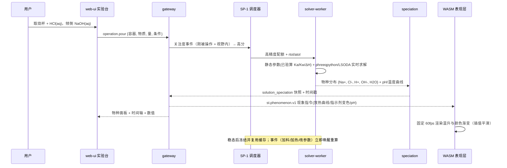

# 01 · 总体架构

> 依据：`CHARTER` 第 0/1/3 条、[决策台账](../11-问题与决策台账.md)。
> 关联 ADR：0002（真实库与动态定量求解）、0003（前后端常驻 / WASM 收窄）、0006（静态参数层 + 动态求解层）、0008（SP-1 自适应定量调度）。
> **v2.0**：初版「四层混合架构 + 断网可玩 + 双视图」已整体作废，本文件按台账重写。

## 一、架构原则

1. **实验台唯一主视图**：只做实验台，一切按实验室规格来。废弃无限画布、落沙沙盒、双视图融合（台账 5.1 / 6.1）。
2. **前后端常驻、服务端为唯一事实源**：求解、物种分布、规则、参数、存档全在服务端；浏览器负责交互与表现；**废弃「断网可玩」**（台账 3.1 / 4.2）。
3. **事实零错、表现夸张**：化学事实层（方向、产物、计量、守恒、平衡趋势、pH / 浓度）严格定量；视觉层（粒子密度、色彩、冲击波、慢放、音效）可夸张；近似规则不得进入事实层（台账 2.1 / 3.3）。
4. **静态参数 + 动态求解**：参数来自权威源且已验算，服务端实时定量求解，隐藏反应、弱 / 可逆 / 电离 / 水解都真实发生（台账 2.3 / 3.4）。
5. **60fps 与定量求解解耦**：WASM 容器内现象固定 60fps 独立渲染，求解结果以快照 + 时间戳异步喂入、插值平滑；算力按 16.7ms 帧预算动态配额给正在观察的过程（SP-1）。
6. **不重复造轮子**：求解器、化学信息学、分子可视化、器材组件、图标全部复用成熟开源项目；自研仅限真实反应库编排、现象映射、产品胶水与内容精校。
7. **许可证边界即架构边界**：AGPL 严格隔离；GPL-3.0 组件选型不纳入；ORD（CC-BY-SA）独立仓物理分离；LPPL 只用编译输出物（ADR-0005）。
8. **全局总成本最低**：不引入 Neo4j / Kafka / Elasticsearch / Kubernetes / Nx；单机自托管优先；**Win + Linux 双平台兼容**为硬约束。

## 二、架构总览

```mermaid
flowchart TB
  subgraph C[浏览器 · 表现层（固定 60fps）]
    UI[React + TS<br/>实验台（唯一主视图）/ 物种面板 / 微观视图 / 时间轴 / 图鉴]
    W[WASM 容器内现象渲染<br/>液体·气泡·沉淀·火焰·飞溅 + 求解加速]
    R2[写实 2D 器材 SVG<br/>tikz-chemlab 输出物为主]
    V3D[3Dmol.js 分子·晶体·球棍模型]
    UI --> R2
    UI --> V3D
    UI <-->|物种分布快照 + 时间戳 + 现象指令| W
  end
  subgraph S[服务端 · 常驻（本地服务器，唯一事实源）]
    GW[API 网关 REST / WS<br/>鉴权 · 会话 · 限流]
    SCHED[SP-1 自适应调度器<br/>关注度分数 · 16.7ms 帧预算 · 事件唤醒]
    SOLVE[动态定量求解器<br/>phreeqpython(主) / SciPy LSODA / chempy(对拍)<br/>Cantera / reaktoro-service(UDS)]
    SPEC[物种分布 / 平衡 / 动力学<br/>pH · 活度 · 电离度 · 沉淀]
    RULES[(真实反应库<br/>静态已验算参数 + 适用条件 + 来源/置信度)]
    TL[(时间轴关键快照<br/>轻量存档)]
    GW --> SCHED --> SOLVE --> SPEC
    SOLVE <--> RULES
    SPEC --> TL
  end
  subgraph D[内容与资产]
    CONTENT[人工精校真实反应库<br/>权威源 → AI 对拍 → 用户签核 → CI 黄金用例]
    ORD[data-ord 独立公开仓 CC-BY-SA-4.0<br/>主仓仅 submodule 引用]
    ART[tikz-chemlab 输出物(写实主资产)<br/>open-lab-components(UI/缩略图) · ASSETS.csv 署名]
    CONTENT --> RULES
    ORD -.事实性反应式.-> RULES
    ART --> R2
  end
  W <-->|现象指令 / 快照 / 操作事件| GW
```

### 分层职责与性能预算

| 层 | 位置 | 职责 | 性能约束 | 关键技术 |
|---|---|---|---|---|
| **内容层** | 仓库 / 独立仓 | 真实反应参数、器材参数、课标知识点映射、资产署名 | 离线，可 review / diff / 回滚 | `content/` + `schemas/` + `ASSETS.csv` |
| **事实层（静态参数）** | 服务端内存 / PG | Ka/Kb/Ksp/E°/ΔG、动力学参数、计量、适用条件；带 `source` / `confidence` / `rule_revision` | 只读、版本化 | 权威源 + AI 对拍 + 用户签核 |
| **求解层（动态）** | 服务端 worker | 物种分布、平衡、动力学、pH / 浓度 / 活度、电离与水解、热效应；隐藏反应真实发生 | 按 SP-1 关注度配额，**不占帧预算** | **phreeqpython（主）** / SciPy LSODA·BDF / Cantera / chempy（对拍）/ pyequion2 / **reaktoro-service（UDS 独立微服务）** |
| **调度层** | 服务端 | 关注度分数、帧预算动态配额、事件唤醒、稳态冻结与缓存 | 16.7ms 帧预算 | SP-1（ADR-0008） |
| **表现层** | 浏览器 WASM / SVG | 容器内现象渲染、写实 2D 器材、分子级 3D、物种面板与时间轴 | **固定 60fps，与求解耗时彻底解耦** | Rust→WASM、WebGL2 / SVG、3Dmol.js |
| **横切 · 教学层** | 长线 | 附加内容，后置到 M4，**不进 M1–M3 验收** | — | 见 `06-教学层设计.md` |

> **帧预算（16.7ms）分配原则**（取代初版「仿真≤8 / 渲染≤6 / UI≤2」的固定切分）：表现层固定 60fps 独占渲染预算；求解任务在**独立 worker** 中运行，按关注度分数动态配额，超预算的体系降频 / 粗粒度 / 冻结并复用缓存。求解耗时**不进入**帧预算，因此重体系不掉帧。

### 前版已删除的部件（勿留死代码）

`Service Worker`、`IndexedDB`、离线规则包、PWA 离线、夜间规则包编译下发、本地 Top-N 二进制规则缓存、512² 落沙网格、无限画布、双视图、`Yjs` 多人协作、复杂存档 diff、`data-ord/` monorepo 子目录、规则包工坊 / 自定义物质编辑器。

## 三、模块边界（逻辑模块 → 后续包划分）

| 模块 | 职责 | 输入 | 输出 | 依赖 |
|---|---|---|---|---|
| `solver` | 服务端动态定量求解 | 体系 + 条件 + 静态参数 | 物种分布 / 曲线 / 数值 | **phreeqpython（主）** / SciPy LSODA·BDF / chempy（对拍）/ Cantera / pyequion2；复杂体系按需路由 `reaktoro-service` |
| `scheduler` | SP-1 自适应调度 | 关注度事件、帧预算 | 求解配额、唤醒 / 冻结 | `solver`、`protocol` |
| `speciation` | 容器物种分布与时间轴 | 求解结果 | `solution_speciation` / `speciation_timeline` | `solver` |
| `reaction-library` | 静态参数加载与校验 | `content/rules/` | 已验算参数 | `schemas/`、CI 黄金用例 |
| `phenomenon` | 现象注册表与指令编排 | 数值结果 | `st.phenomenon.v1` 指令 | `protocol` |
| `apparatus` | 实验台器材逻辑与资产 | 器材 ID + 参数 | 2D SVG + 容器容量 / 物理约束 | 美术资产层 |
| `wasm-view` | 容器内现象即时渲染 | 快照 + 现象指令 | 60fps 渲染帧 | `protocol` |
| `web-ui` | 实验台、物种面板、微观视图、时间轴、图鉴 | 用户操作 | 指令 | 全部 |
| `gateway` | REST/WS/鉴权/会话/限流 | HTTP/WS | 响应 | Redis / PG |
| `save` | 轻量存档 + 关键快照回放 | 会话状态 | 存档 / 回放 | `protocol` |
| `teaching` | **长线**：课标知识点映射、教学附加内容 | — | — | **不进 M1–M3** |

**关键解耦**：`solver` 只认识物种与数值，不认识渲染；`wasm-view` 只认识现象 ID，不认识分子；二者通过 `st.phenomenon.v1` 协议通信（见 `03`）。渲染器、求解器可独立替换。

## 四、部署拓扑（Docker Compose）

| 服务 | 镜像/技术 | 端口 | 说明 | 可裁剪 |
|---|---|---|---|---|
| `web` | Nginx + 静态前端 | 80/443 | React 构建产物 + 写实 2D 资产 | 否 |
| `gateway` | **Node/Fastify (TS)**（D4 已锁定） | 3000 | REST + WS + 鉴权 | 否 |
| `solver-worker` | Python 3.11 + phreeqpython/SciPy/Cantera/chempy | 内部 | 动态定量求解（独立 worker，资源隔离） | 否 |
| `reaktoro-service` | conda 镜像 + Reaktoro(LGPL-2.1 动态链接) | 内部 UDS | 多相 / 极端条件 / 复杂体系平衡终态，按需路由 | 否 |
| `postgres` | PostgreSQL（+ 可选 RDKit Cartridge 做结构检索） | 5432 | 主库 | 否 |
| `redis` | Redis | 6379 | 缓存 + 会话 | 单机可省 |
| `minio` | MinIO 或本地卷 | 9000 | 存档 / 快照 / 资产 | 单机可用本地卷 |
| `caddy` | Caddy | 443 | 反代 + 自动 HTTPS | 可选 |

**单机最小部署（M1）**：`web + gateway + solver-worker + postgres + 本地卷`。单机 / 多机 / 公共 Demo 形态**延后到阶段二决策**（台账 9.1「到时候再说」）。

### Win + Linux 双平台兼容（硬约束 C28）

| 坑 | 对策 |
|---|---|
| CRLF / LF | `.gitattributes` 强制 `* text=auto eol=lf`；`.sh` / `.yml` / 配置一律 LF |
| 路径大小写 | 全仓路径统一**小写 + snake_case**；禁止仅靠大小写区分的文件名 |
| 卷挂载 | Docker Desktop / WSL2 与 Linux 的挂载语法差异在 M0 双平台各测一次；文档给两套命令 |
| 文件权限 | 容器以非 root 运行；`chmod` 不依赖宿主 umask |
| 端口占用 | `.env.example` 可配置所有端口；M0 检查 Windows 常见占用 |
| TeX 转换管线 | 全程在 Docker 内执行，不依赖宿主 TeX 发行版 |

## 五、容量与性能估算（按 SP-1，M1 实测校准）

| 项 | 估算 / 口径 | 依据 |
|---|---|---|
| 帧预算 | 16.7ms/帧，表现层固定 60fps | SP-1 |
| 求解配额 | 按关注度分数动态分配；焦点内高精度、焦点外降频 / 冻结 / 缓存 | ADR-0008 |
| 数值自适应 | 步长由 **SciPy LSODA/BDF 内置局部误差 + `rtol`/`atol`** 决定；自动刚性检测切 BDF ↔ Adams；**无硬编码时间阈值**（CVODES 后置 M1 可选加速） | SP-1 第 1 层 / D3 |
| 快照频率 | 焦点内密集、焦点外稀疏；只存关键快照 + 增量事件 | 台账 3.2 / 9.4 |
| 反应覆盖 | **1000 个完全仿真反应下限**，长线不封顶；每个新增体系必须可玩、已验算 | 台账 1.1 / 2.4 |
| 资料卡 | 不再以「上万化合物可查」为目标；PubChem 为离线候选池 | 台账 1.3 / 2.2 |
| 求解缓存 | key = 体系 + 条件哈希 + `ruleset_version`；稳态复用 | SP-1 第 4 层 |
| 带宽 | 服务端→客户端只推「物种分布快照 + 现象指令」，不推网格数据 | 表现解耦 |

## 六、数据流（一次「把盐酸倒进氢氧化钠溶液」）



## 七、架构级风险（详见风险登记册）

| 风险 | 架构对策 |
|---|---|
| 定量求解拖慢体验 | SP-1 四层解耦：求解在独立 worker，表现层固定 60fps，异步快照 + 插值 |
| 刚性体系不收敛 / 资源耗尽 | SciPy LSODA/BDF 自适应步长 + 自动刚性切换；worker CPU / 内存 / 超时上限；事件唤醒与稳态冻结 |
| 隐藏反应露馅 | `solution_speciation` 让不可见反应也真实发生，容器物种面板可查（台账 3.2） |
| 数值错误 | 静态参数已验算 + AI 对拍 + 用户签核 + CI 黄金用例；近似不进事实层 |
| 实验台表现力不足 | 12 类现象 + 四类好玩载体 + 视觉夸张（不触碰事实层） |
| GPL / AGPL 传染 | CI 白名单 + `lgpl-link-check`；AGPL 严格隔离；ORD 独立仓 |
| LPPL / CC-BY 署名遗漏 | `ASSETS.csv` + CI 覆盖检查；只转译编译输出物 |
| 双平台兼容 | `.gitattributes` + 路径规范 + M0 双平台验证清单 |
| 单点故障 | 服务无状态可重建；PG / 卷备份；`ruleset_version` 保证存档可解释 |
