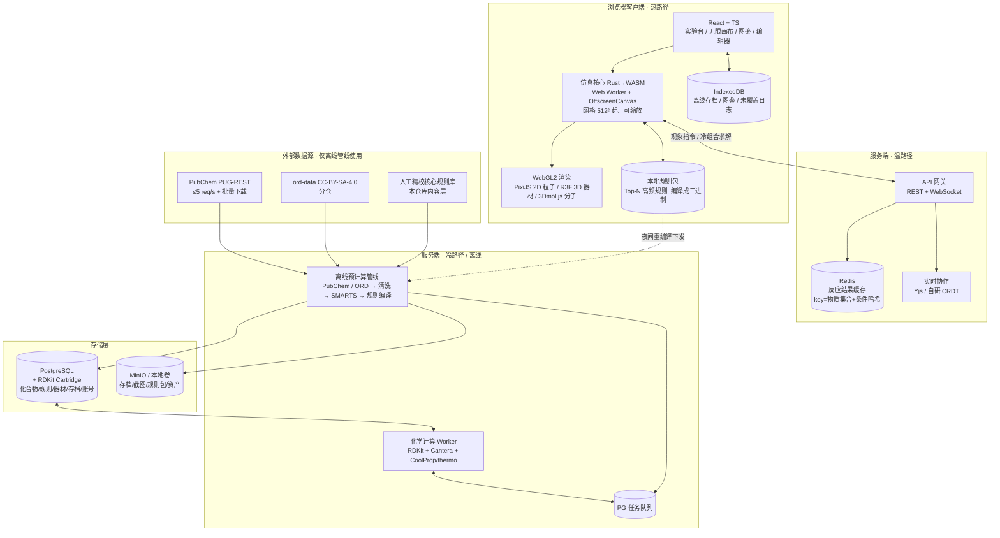
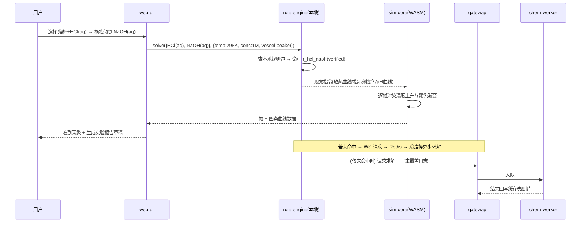

# 01 · 总体架构

> 依据：`CHARTER` D1 混合分层 / D2 Web + 后端重计算 / D4 上万物质。
> 关联 ADR：0002（分层）、0003（WASM）、0006（规则数据驱动）。

## 一、架构原则

1. **好玩与网络/数据规模解耦**：核心玩法由浏览器内 WASM + 本地规则包驱动，**断网可玩**。上万化合物、重计算、账号与工坊才依赖服务端。
2. **正确性优先于规模**：任何反应必须命中带 `source / confidence / conditions` 的规则才产生现象；未命中返回明确的「无明显变化」。
3. **不重复造轮子**：L0 借 Sandspiel、化学计算借 RDKit/Cantera、渲染借 PixiJS/R3F/3Dmol.js、美术借开源资产；自研仅限规则编排、现象映射、产品胶水、内容精校。
4. **许可证边界即架构边界**：GPL/AGPL 组件在进程与构建产物层面物理隔离；CC-BY-SA 数据独立仓库。
5. **全局总成本最低**：不引入 Neo4j（反应网络用 PG 递归 CTE）、不引入独立搜索引擎（子结构检索用 RDKit Cartridge）、不引入 Kafka（任务用 PG 队列表 + Redis 缓存）。

## 二、四层架构

### 各层职责与性能预算

| 层 | 位置 | 职责 | 延迟目标 | 关键技术 |
|---|---|---|---|---|
| **L0 表现层** | 浏览器 WASM | 粒子/流体/相变、热传导、压强、扩散、火焰、电流；把现象指令渲染成变色/气泡/沉淀/爆炸/结晶/烟雾 + 曲线 | **60fps，零 RTT** | Rust→WASM、Web Worker、OffscreenCanvas、WebGL2 浮点纹理 |
| **L1 化学逻辑层** | 客户端本地规则包 + 服务端 | 条件化规则匹配、化学计量、现象编排、置信度与兜底 | 热 < 1ms；温 < 20ms | 编译后的规则二进制 + 哈希索引 |
| **L2 数值计算层** | 服务端 Worker（异步） | RDKit SMARTS 模板匹配、Cantera/CoolProp 动力学与平衡、首次组合求解 | 秒级，前端不阻塞 | Python worker + 任务队列 + 永久缓存 |
| **L3 数据层** | 服务端 | 上万化合物资料卡、规则库、器材库、账号、存档、未覆盖日志 | 子结构检索走 Cartridge 索引 | PostgreSQL + RDKit Cartridge |
| **横切 · 教学层** | 两端 | 教材模板、分步纠错、实验报告、操作测评、教师端、LTI/xAPI | M3 | 见 `06-教学层设计.md` |

### 三级路径（性能设计核心）

| 路径 | 触发 | 行为 | 用户感知 |
|---|---|---|---|
| **热** | 常见物质组合、粒子运动 | 客户端本地规则包命中 → 本地现象指令 | 0 网络，60fps |
| **温** | 次常见组合 | WS 请求 → Redis 缓存命中 → 返回现象指令 | < 20ms |
| **冷** | 首次遇到的组合 | 入队 → Python worker 求解 → 回写缓存与规则库；前端先显示「计算中…」并**继续跑粒子动画** | 秒级但不卡画面 |

> **预计算**：夜间批量跑高频组合（按未覆盖日志频次排序），把结果写入规则包与缓存；白天绝大多数请求命中热/温路径。

## 三、模块边界（逻辑模块 → 后续包划分）

| 模块 | 职责 | 输入 | 输出 | 依赖 |
|---|---|---|---|---|
| `sim-core` | L0 粒子/物理仿真 | 器材/物质放置、现象指令 | 网格状态 + 渲染帧 | 规则包（数据驱动） |
| `rule-engine` | L1 规则匹配与编排 | `(物质集合, 条件)` | 现象指令 / 兜底 | 规则表、置信度 |
| `chem-worker` | L2 重计算 | 冷组合任务 | 反应结果 + 建议规则 | RDKit / Cantera / CoolProp |
| `data-pipeline` | 离线编译 | PubChem / ORD / 人工库 | 规则包 + PG 记录 | ORDerly / RDKit |
| `phenomenon` | 现象注册表 | 现象指令 | 粒子/材质/曲线参数 | sim-core |
| `apparatus` | 器材逻辑与资产 | 器材 ID + 参数 | 2D SVG / 3D 几何 + 容器容量 | 美术资产层 |
| `web-ui` | 双视图、编辑器、图鉴、报告 | 用户操作 | 指令 | 全部 |
| `gateway` | REST/WS/鉴权/缓存 | HTTP/WS | 响应 | Redis / PG |
| `teaching` | 教材/纠错/报告/测评/LTI | 教学过程事件 | 报告/xAPI 语句 | ltijs / xAPI |

**关键解耦**：`sim-core` 只认识「表现材质 ID」，不认识化学分子；`rule-engine` 只认识规则与现象 ID，不认识渲染。二者通过**现象指令协议**通信（见 `03`）。

## 四、部署拓扑（Docker Compose）

| 服务 | 镜像/技术 | 端口 | 说明 | 可裁剪 |
|---|---|---|---|---|
| `web` | Nginx + 静态前端 | 80/443 | React 构建产物 + 资产 CDN | 否 |
| `gateway` | Node/Fastify 或 Rust/axum | 3000 | REST + WS + 鉴权 | 否 |
| `chem-worker` | Python + RDKit/Cantera | 内部 | 冷路径计算 | M2 起需要 |
| `precompute` | Python 批处理 | 内部 | 夜间规则编译 | M2 起需要 |
| `postgres` | PostgreSQL + RDKit Cartridge | 5432 | 主库 | 否 |
| `redis` | Redis | 6379 | 缓存 + 会话 | 单机可省 |
| `minio` | MinIO 或本地卷 | 9000 | 存档/规则包 | 单机可用本地卷 |
| `caddy` | Caddy | 443 | 反代 + 自动 HTTPS | 可选 |

**单机最小部署（M1）**：`web + gateway + postgres + redis + 本地卷`，`chem-worker` 可内嵌为 gateway 的线程池，M2 再拆出。**保证一台 4C8G 服务器能跑起来**是自托管的最低门槛。

## 五、容量与性能估算（判断，M1 实测校准）

| 项 | 估算 | 依据/对策 |
|---|---|---|
| 粒子网格 | 512×512 = 262k cell，每 cell 4 byte → ~1MB | Rust 结构体数组，双缓冲；WebGL 纹理上传 |
| 60fps 预算 | 16.6ms/帧：仿真 ≤ 8ms、渲染 ≤ 6ms、UI ≤ 2ms | Worker 隔离，UI 不参与逐帧 |
| 表现型材质 | ≤ 512 种（u8 ID 足够） | 与上万化合物是多对一映射 |
| 本地规则包 | Top 2000 条规则，二进制 < 2MB | 启动即加载，IndexedDB 缓存版本 |
| 化合物资料卡 | 10,000~100,000 条 | PG + Cartridge；只存常用字段，冷门字段按需查 PubChem |
| RDKit.js WASM | 体积待测（M0） | 仅资料卡/结构式编辑页按需懒加载，不进主 bundle |
| 反应缓存 | key = 物质集合 + 条件哈希 | Redis LRU；命中率目标 > 95%（靠未覆盖日志预计算） |
| 并发 | 单机 50~200 WS 连接 | 无状态 gateway，可水平扩展 |

## 六、数据流（一次「把盐酸倒进氢氧化钠溶液」）

## 七、架构级风险（详见风险登记册）

| 风险 | 架构对策 |
|---|---|
| WASM 网格性能不足 | 网格可缩放、Worker 隔离、双缓冲、脏矩形更新；降级到 256² |
| 冷路径拖慢体验 | 异步 + 前端继续动画 + 永久缓存 + 夜间预计算 |
| 「上万物质」压垮客户端 | 三层分离，资料卡只在服务端；客户端只载表现材质与 Top-N 规则 |
| GPL 传染 | 组件清单进 CI 检查（依赖许可证白名单），构建产物不并入 GPL 代码 |
| CC-BY-SA 传染 | 数据独立仓库、独立署名，衍生规则只保留事实 |
| 化学正确性 | 规则带 source/confidence；低置信只进图鉴；界面标注教学近似 |
| 单点故障 | 全部服务无状态，PG/卷可备份；单机可裁剪到 3 个容器 |
