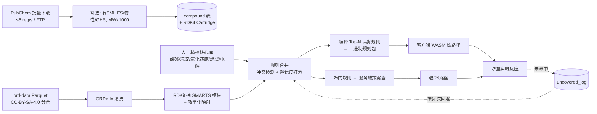

# 03 · 数据模型与反应规则 Schema

> **这是整个系统的核心数据结构**。它决定了「上万物质」能否兑现、化学正确性能否追溯、现象能否解耦渲染。
> 关联 ADR：0002（分层）、0006（规则数据驱动）。

## 一、三层概念严格分离（防止规模目标自相矛盾）

| 概念 | 表 | 量级 | 客户端可见 | 说明 |
|---|---|---|---|---|
| **可查询化合物** | `compound` | 10k–100k | 按需（资料卡） | PubChem 导入，有结构/物性/GHS；**绝大多数不能参与实时反应** |
| **可反应物质** | `substance` | 数百–数千 | 是（规则包） | 绑定化合物 + 相态/浓度/溶剂；有规则覆盖才能产生现象 |
| **表现型材质** | `material` | ≤ 512 | 是（WASM 网格） | 与可反应物质多对一映射，只负责渲染与物理 |

> 一条 `compound`（如「乙醇」）可对应多个 `substance`（无水乙醇、95% 乙醇、乙醇水溶液），多个 `substance` 可共用一个 `material`（透明液体）。**这条映射是 D4 规模目标能成立的关键**。

## 二、核心 Schema

### 2.1 `compound` — 化合物资料卡

```json
{
  "id": "cid:702",
  "cid": 702,
  "names": {"zh": "乙醇", "en": "Ethanol", "aliases": ["酒精"]},
  "formula": "C2H6O",
  "smiles": "CCO",
  "inchi": "InChI=1S/C2H6O/c1-2-3/h3H,2H2,1H3",
  "inchikey": "LFQSCWFLJHTTHZ-UHFFFAOYSA-N",
  "mass": 46.07,
  "properties": {
    "mp_K": 159, "bp_K": 351, "density_g_cm3": 0.789,
    "solubility_water": "miscible", "flash_K": 286,
    "appearance": "无色液体"
  },
  "safety": {"ghs": ["H225", "H319"], "signal": "Danger", "hazard": "高度易燃"},
  "structure2d_svg": "assets/structure/cid702.svg",
  "source": {"type": "pubchem", "url": "https://pubchem.ncbi.nlm.nih.gov/compound/702", "fetched_at": "2026-11-14"},
  "license": "PubChem 公开数据"
}
```

### 2.2 `substance` — 可反应物质（试剂）

```json
{
  "id": "sub:hcl_aq_1M",
  "compound_ref": "cid:313",
  "label": "盐酸 (1 mol/L)",
  "phase": "aqueous",
  "concentration_M": 1.0,
  "solvent": "water",
  "material_ref": "mat:clear_acid_liquid",
  "roles": ["acid", "strong_electrolyte"],
  "default_amount_mmol": 10,
  "safety": {"corrosive": true, "real_life_warning": "强酸，稀释会放热飞溅"}
}
```

### 2.3 `material` — 表现型材质（进 WASM 网格）

```json
{
  "id": "mat:clear_acid_liquid",
  "render": {"color": "#dfefff", "opacity": 0.85, "pattern": "liquid"},
  "physics": {"phase": "Liquid", "density": 1.02, "viscosity": 0.9, "diffusion": 0.6},
  "thermal": {"cp": 4.0, "conductivity": 0.6, "bp_K": 373, "mp_K": 273, "ignition_K": null},
  "electrical": {"conductivity": 12.0},
  "reactivity_class": "strong_acid",
  "flags": ["pourable", "corrosive", "indicator_responsive"]
}
```

### 2.4 `apparatus` — 器材（单一事实源，驱动 2D/3D/物理）

```json
{
  "id": "app:beaker_250",
  "names": {"zh": "烧杯 250 mL", "en": "Beaker 250 mL"},
  "capacity_mL": 250,
  "graduations_mL": [50, 100, 150, 200, 250],
  "mouth_diameter_mm": 65,
  "max_temp_K": 873,
  "sealable": false,
  "pourable": true,
  "connectable": [],
  "asset": {
    "svg": "assets/labware/beaker.svg",
    "svg_source": "tikz-chemlab / open-lab-components",
    "svg_license": "LPPL-1.3c(输出物) / MIT",
    "liquid_layer_id": "liquid-path",
    "geometry3d": {"type": "lathe", "profile": "assets/labware/beaker.profile.json"}
  },
  "physics": {"wall_thickness": 2, "break_pressure_kPa": 250}
}
```

### 2.5 `reaction_rule` — 条件化反应规则（核心）

```yaml
id: r_hcl_naoh_neutralization
version: 3
title: 盐酸与氢氧化钠中和
reactants:
  - {ref: "sub:hcl_aq_1M", coeff: 1, role: acid}
  - {ref: "sub:naoh_aq_1M", coeff: 1, role: base}
conditions:
  temp_K: [273, 373]
  concentration_M: [0.001, 12]
  pressure_kPa: [80, 120]
  ph_range: null
  solvent: water
  catalyst: null
  light: null
  apparatus_requires: ["pourable"]
  apparatus_forbids: ["sealed"]
products:
  - {ref: "sub:nacl_aq", coeff: 1}
  - {ref: "sub:water", coeff: 1}
stoichiometry: {"sub:hcl_aq_1M": 1, "sub:naoh_aq_1M": 1}
thermo: {deltaH_kJ_per_mol: -57.3, model: "strong_acid_strong_base"}
kinetics: {model: "instant", rate_constant: null, activation_energy_kJ: null}
smarts: "[Cl-].[Na+].[OH-].[H+]>>[Cl-].[Na+].O"
effects:
  - {type: "temperature_rise", from: "thermo", curve: [[0,25],[2,41],[10,25]]}
  - {type: "ph_curve", model: "strong_acid_strong_base"}
  - {type: "indicator_color", depends_on: "indicator"}
  - {type: "color_lerp", from: "#ffd0d0", to: "#e8f4ff", duration_ms: 800}
  - {type: "sound", id: "fizz_soft"}
safety: {hazard: "exothermic", real_life_warning: "强酸强碱稀释会放热飞溅"}
confidence: verified
source:
  type: textbook
  ref: "人教版 九年级下册 酸碱中和"
  url: null
  reviewed_by: "content-team"
  reviewed_at: "2026-11-14"
tags: ["中和", "酸碱", "初中", "放热"]
fallback_hint: "试试改变浓度或加入指示剂"
```

**四个成败字段**：
- `conditions` —— 解决「任意混合不可判定」；连续量在引擎里离散成条件桶。
- `effects` —— 把化学结果翻译成可渲染的现象指令（前后端解耦）。
- `confidence` —— `verified`(人工精校, 进沙盒) / `extracted`(ORD 抽取, 需复核) / `community`(社区) / `ml_guess`(仅图鉴)。
- `source` —— 可溯源、可审计、可回滚；低置信规则不进实时沙盒。

### 2.6 现象指令协议（前后端唯一契约）

```json
{
  "protocol": "ocl.phenomenon.v1",
  "reaction_id": "r_hcl_naoh_neutralization",
  "effects": [
    {"type": "spawn_particles", "material": "mat:water", "count": 1200, "at": "vessel_3"},
    {"type": "color_lerp", "from": "#ffd0d0", "to": "#e8f4ff", "duration_ms": 800},
    {"type": "temperature", "curve": [[0,25],[2,41],[10,25]]},
    {"type": "ph", "curve": [[0,1.0],[4,7.0],[8,13.0]]},
    {"type": "sound", "id": "fizz_soft"}
  ],
  "confidence": "verified",
  "fallback": null
}
```

未命中时：`{"fallback":"no_visible_change","hint":"试试加热或改变浓度"}`。

> 服务端只返回「发生了什么」，不关心画面；渲染器可替换（Canvas2D / WebGL / 3D / 甚至纯文字无障碍模式）。

## 三、关系与索引（PostgreSQL）

| 表 | 主键 | 索引 | 说明 |
|---|---|---|---|
| `compound` | `id` | `cid` unique、`smiles`(Cartridge `mol` 列 + GiST)、`inchikey` | 子结构/相似检索走 RDKit Cartridge |
| `substance` | `id` | `compound_ref`、`roles` GIN | 试剂 |
| `material` | `id` | `reactivity_class` | ≤512 行，随规则包下发 |
| `apparatus` | `id` | — | 器材 |
| `reaction_rule` | `id` | GIN(`reactants`)、`confidence`、`tags` GIN | 规则主体 |
| `rule_revision` | `(id, version)` | — | 变更历史与回滚 |
| `phenomenon` | `type` | — | 12 类现象注册表 |
| `experiment_template` | `id` | 教材/章节/知识点 | M3 教学层 |
| `save` | `id` | `user_id`、分享 token | 存档 |
| `uncovered_log` | `(a,b,cond_hash)` | `count` DESC | 数据飞轮的补规则队列 |
| `solve_cache` | `key` | Redis（不在 PG） | 温路径 |

**刻意不引入 Neo4j**：反应网络（物质 ↔ 规则 ↔ 现象）用 PG 递归 CTE + GIN 索引足够，少一个组件、少一套运维（全局总成本最低）。

## 四、规则编译（离线 → 客户端）



**教学化映射（关键，不能整包塞进沙盒）**：ORD 以有机/专利文献反应为主，带产率、副产物、复杂条件，与中学「混合就变色/冒泡」直觉差别很大。只抽取：
- 条件简单（室温/常压/常见溶剂）、现象明显（产气/沉淀/显色）、置信度高的子集；
- 其余降级为「资料卡 + 已知反应式」，不进实时沙盒；
- 抽取结果一律标 `confidence: extracted`，人工复核后才升 `verified`。

**数据飞轮**：每次 `no_visible_change` 记一条 `(物质A, 物质B, 条件桶, 次数)`，按频次排队补规则；夜间预计算生成结果表并回灌缓存。内容生产从「人肉堆」变成「按需求补」。

## 五、规则冲突与正确性校验（CI 必跑）

| 检查 | 说明 |
|---|---|
| 计量守恒 | 反应前后元素守恒（用 RDKit 校验；教学近似允许显式标注 `approximate`） |
| 条件互斥 | 同一 `(reactants, 条件桶)` 不得存在两条 `verified` 规则 |
| 置信度闸门 | 非 `verified` 规则不得进客户端规则包 |
| 来源完整性 | `source` 必填；`extracted` 必须带 ORD dataset_id / reaction_id |
| 黄金用例集 | 教材代表实验（中和、制氧、置换、沉淀、电解…）逐条断言现象与曲线 |
| 许可证标记 | 每条 ORD 衍生规则带 `CC-BY-SA-4.0` 溯源字段 |

## 六、存档格式（开放、可 diff、可分享）

```json
{
  "format": "ocl.save.v1",
  "meta": {"title": "我的爆炸实验", "author": "user:123", "created_at": "2026-11-14T08:00:00Z"},
  "view": "bench",
  "grid": {"width": 512, "height": 512, "encoding": "rle+base64", "data": "..."},
  "apparatus": [{"ref": "app:beaker_250", "x": 120, "y": 200, "rotation": 0, "params": {"volume_mL": 100}}],
  "substances": [{"ref": "sub:hcl_aq_1M", "amount_mmol": 10, "in": "app:beaker_250#0"}],
  "timeline": [{"t_ms": 0, "action": "pour", "..." : "..."}],
  "curves": {"temperature": [[0,25],[2000,41]], "ph": [[0,1],[4000,7]]},
  "ruleset_version": "core-2026.11.14"
}
```

- 网格用 RLE + base64（可压缩、可 diff）；`ruleset_version` 保证不同版本规则下重放结果可解释。
- 分享链接仅存 `save_id`，内容在自托管服务端，**不依赖任何第三方云**。
- 多人协作（M4）用 Yjs CRDT 合并 `timeline` 与器材布局，网格状态以服务端为准。

## 七、Schema 演进原则

1. 所有实体带 `version`/`schema` 字段，读取时向前兼容，写入时校验。
2. 规则变更必须走 `rule_revision`，禁止原地覆盖（可回滚、可审计）。
3. JSON Schema 文件进仓库 `schemas/`，CI 用 `ajv` 校验所有规则与资产文件。
4. 字段命名用英文 snake_case，展示名走 i18n（zh-CN 默认 + en）。
