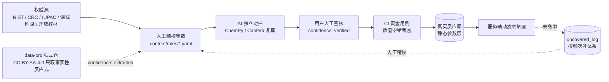

# 03 · 数据模型与反应规则 Schema

> **这是整个系统的事实层数据结构**。它决定「1000 个完全仿真反应」能否兑现、化学正确性能否追溯、现象能否与渲染解耦。
> 依据：台账 1.3 / 2.2 / 2.3 / 3.2 / 4.4 / 7.3 / 9.3 / 9.4 / 10.3；关联 ADR：0002、0006、0008。
> **v2.0**：初版「compound / substance / material 三层分离 + 表现型粒子 ≤512 + 网格存档 + Yjs」已作废，本文件按台账重写。

## 一、资料卡即可玩库（推翻三层分离）

台账 1.3「**凡进资料卡必须可玩**」与 2.2「**资料卡即可玩库**」推翻了初版三层概念：

| 初版概念 | v2.0 处置 |
|---|---|
| 可查询化合物（PubChem 10k–100k 资料卡） | ❌ 作废。**PubChem 降级为离线候选池**，不再以「上万化合物资料卡可查」为验收目标 |
| 可反应物质（`substance`） | ✅ 合并进 **`compound` 可玩物质卡**：凡入库必须可玩、已验算、有规则覆盖 |
| 表现型材质（`material`，≤512 进 WASM 网格） | ❌ 作废。落沙网格已废弃；表现参数作为 `phenomenon` 渲染元数据，不是事实层实体 |
| 隐藏化学态 | ✅ **新增** `solution_speciation` / `speciation_timeline`：不可见反应也真实发生、可查、可回放（台账 3.2） |

**规模口径**：**1000 个完全仿真反应为下限**（含弱 / 可逆 / 电离 / 水解），长线不封顶；每个新增物质必须可玩。数量以「反应」计，不以「物质 / 资料卡」计（台账 1.1 / 2.4）。

## 二、核心 Schema

### 2.1 `compound` — 可玩物质卡（资料卡即可玩库）

```json
{
  "id": "sub:hcl_aq_1M",
  "names": {"zh": "盐酸 (1 mol/L)", "en": "Hydrochloric acid (1 M)", "aliases": ["氢氯酸"]},
  "formula": "HCl",
  "smiles": "Cl",
  "inchikey": "VEXZGXHMUGYJMC-UHFFFAOYSA-N",
  "phase": "aqueous",
  "concentration_M": 1.0,
  "solvent": "water",
  "roles": ["acid", "strong_electrolyte"],
  "properties": {
    "density_g_cm3": 1.02, "cp_J_gK": 4.0,
    "mp_K": 247, "bp_K": 381,
    "appearance": "无色液体"
  },
  "safety": {"ghs": ["H314"], "corrosive": true, "real_life_warning": "强酸，稀释会放热飞溅"},
  "i18n": {"term_zh": "盐酸", "term_en": "Hydrochloric acid", "equation_zh": "HCl → H⁺ + Cl⁻", "equation_en": "HCl → H+ + Cl-"},
  "playable": true,
  "source": {"type": "nist_crc", "ref": "CRC Handbook 97th, …", "url": "…", "fetched_at": "2026-11-14"},
  "confidence": "verified",
  "review": {"ai_crosscheck": "chempy/0.9.1 ΔpH < 1e-6", "signed_by": "stellarissss", "signed_at": "2026-11-14"}
}
```

> `playable: true` 是硬约束：不可玩的物质卡不允许入库（台账 1.3）。`i18n` 落实 7.3「UI 简中 + 英 · 内容双语」；文档仍仅简体中文。

### 2.2 `apparatus` — 实验台器材（单一事实源）

```json
{
  "id": "app:beaker_250",
  "names": {"zh": "烧杯 250 mL", "en": "Beaker 250 mL"},
  "capacity_mL": 250,
  "graduations_mL": [50, 100, 150, 200, 250],
  "mouth_diameter_mm": 65,
  "max_temp_K": 873,
  "sealable": false,
  "pourable": true,
  "connectable": [],
  "asset": {
    "svg": "assets/labware/beaker.svg",
    "svg_source": "tikz-chemlab (generated output)",
    "svg_license": "LPPL-1.3c (output only)",
    "liquid_layer_id": "liquid-path"
  },
  "physics": {"wall_thickness_mm": 2, "break_pressure_kPa": 250}
}
```

> v2.0 变化：删除 `geometry3d.profile`（程序化 3D 器材降级长线，ADR-0007）。参数表仍驱动 2D SVG、容器容量、物理约束与实验台交互。

### 2.3 `reaction_rule` — 条件化真实反应（核心）

```yaml
id: r_hcl_naoh_neutralization
version: 3
title: 盐酸与氢氧化钠中和
names: {zh: 盐酸与氢氧化钠中和, en: HCl + NaOH neutralization}
reactants:
  - {ref: "sub:hcl_aq_1M", coeff: 1, role: acid}
  - {ref: "sub:naoh_aq_1M", coeff: 1, role: base}
products:
  - {ref: "sub:nacl_aq", coeff: 1}
  - {ref: "sub:water", coeff: 1}
stoichiometry: {"sub:hcl_aq_1M": 1, "sub:naoh_aq_1M": 1}

# —— 静态已验算参数（定量，非近似）——
equilibrium:
  Ka: null
  Kb: null
  Ksp: null
  E0: null
  deltaG_kJ_per_mol: -79.9
  Kw: 1.0e-14
kinetics: {model: "instant_algebraic", rate_constant: null, activation_energy_kJ: null}
thermo: {deltaH_kJ_per_mol: -57.3, model: "strong_acid_strong_base"}

# —— 适用条件（解决「任意混合不可判定」）——
applicability:
  temp_K: [273, 373]
  concentration_M: [0.001, 12]
  pressure_kPa: [80, 120]
  solvent: water
  ionic_strength_M: [0, 2]
  ph_range: null
  catalyst: null
  light: null
  apparatus_requires: ["pourable"]
  apparatus_forbids: ["sealed"]

# —— 数值与调度（呼应 ADR-0008）——
numerics: {rtol: 1e-8, atol: 1e-10, stiffness: auto, significance: auto}

# —— 现象指令（不是渲染代码）——
effects:
  - {type: "temperature_rise", from: "thermo", curve: [[0,25],[2,41],[10,25]]}
  - {type: "ph_curve", model: "strong_acid_strong_base"}
  - {type: "indicator_color", depends_on: "indicator"}
  - {type: "color_lerp", from: "#ffd0d0", to: "#e8f4ff", duration_ms: 800}
  - {type: "sound", id: "fizz_soft"}

safety: {hazard: "exothermic", real_life_warning: "强酸强碱稀释放热飞溅"}
confidence: verified
source:
  type: textbook_nist
  ref: "人教版 九年级下册 酸碱中和；NIST ΔfG° 表"
  url: null
  reviewed_by: "stellarissss"
  reviewed_at: "2026-11-14"
ai_crosscheck: {tool: "chempy/0.9.1 + cantera/3.0", result: "pH(eq)=7.00, ΔT=+16.0K", match: true}
curriculum:
  knowledge_points: ["酸碱中和", "离子反应", "放热反应"]
  stages: ["初中"]
  textbooks: ["人教版 九年级下册", "教科版 九年级", "苏教版 九年级", "沪科版 九年级"]
tags: ["中和", "酸碱", "初中", "放热"]
fallback_hint: "试试改变浓度或加入指示剂"
smarts: "[Cl-].[Na+].[OH-].[H+]>>[Cl-].[Na+].O"
```

**成败字段**：

| 字段 | 作用 |
|---|---|
| `equilibrium` / `kinetics` / `thermo` | 静态已验算**定量**参数，动态求解层的输入（ADR-0006） |
| `applicability` | 解决「任意混合不可判定」；连续量由求解器处理，**不离散成硬编码条件桶** |
| `numerics` | `rtol` / `atol` / `stiffness: auto` / `significance: auto`（SP-1） |
| `confidence` / `source` / `ai_crosscheck` / `review` | 权威源 + AI 独立对拍 + 用户签核（台账 4.4 / 10.3） |
| `curriculum` | 内容按**课标知识点**组织、多版本教材标注（台账 9.3）；**不等于内置教学功能** |
| `effects` | 把化学结果翻译成现象指令（前后端解耦） |

### 2.4 `solution_speciation` — 每容器隐藏化学态（新增）

```json
{
  "container_id": "vessel_3",
  "t_ms": 4200,
  "species": [
    {"ref": "sub:na_plus", "amount_mmol": 10.0, "concentration_M": 0.10, "activity": 0.096, "phase": "aq"},
    {"ref": "sub:cl_minus", "amount_mmol": 10.0, "concentration_M": 0.10, "activity": 0.096, "phase": "aq"},
    {"ref": "sub:h_plus", "concentration_M": 1.0e-7, "phase": "aq"}
  ],
  "ph": 7.00,
  "ionic_strength_M": 0.10,
  "temperature_K": 298.15,
  "equilibria": [{"rule_id": "r_hcl_naoh_neutralization", "extent": 1.0, "deltaG_kJ": -79.9}],
  "precipitates": [],
  "complexes": [],
  "ionization_degree": 1.0,
  "hidden_reactions": [{"rule_id": "r_water_autoprotolysis", "extent": 1.0e-7}]
}
```

> 台账 2.2 补充：不可见反应也要能发生，容器内物质与主要反应可见 —— 否则突变 / 加指示剂会露馅。物种面板与微观视图直接读这份数据。

### 2.5 `speciation_timeline` — 关键快照时间轴（新增）

```json
{
  "format": "st.timeline.v1",
  "session_id": "sess_42",
  "keyframes": [
    {"t_ms": 0,    "speciation_ref": "snap:0",    "events": [{"action": "pour", "ref": "sub:hcl_aq_1M", "amount_mmol": 10}]},
    {"t_ms": 2000, "speciation_ref": "snap:2000", "events": [{"action": "pour", "ref": "sub:naoh_aq_1M", "amount_mmol": 10}]},
    {"t_ms": 4200, "speciation_ref": "snap:4200", "events": []}
  ],
  "curves": {
    "temperature_K": [[0,298.15],[2000,314.1],[4200,298.15]],
    "ph": [[0,1.0],[2000,7.0],[4200,7.0]],
    "pressure_kPa": [[0,101.3]],
    "mass_g": [[0,100.0]]
  },
  "ruleset_version": "core-2026.11.14"
}
```

只存**关键快照 + 增量事件**（台账 9.4 轻量存档）；废弃全量网格 RLE、Yjs CRDT 合并与复杂存档 diff。

### 2.6 现象指令协议（前后端唯一契约）

```json
{
  "protocol": "st.phenomenon.v1",
  "container_id": "vessel_3",
  "timestamp_ms": 4200,
  "speciation_ref": "snap:4200",
  "effects": [
    {"type": "spawn_particles", "material": "mat:water", "count": 1200, "at": "vessel_3"},
    {"type": "color_lerp", "from": "#ffd0d0", "to": "#e8f4ff", "duration_ms": 800},
    {"type": "temperature", "curve": [[0,25],[2,41],[10,25]]},
    {"type": "ph", "curve": [[0,1.0],[4,7.0],[8,13.0]]},
    {"type": "sound", "id": "fizz_soft"}
  ],
  "confidence": "verified",
  "fallback": null
}
```

未命中时：`{"fallback":"no_visible_change","hint":"试试加热或改变浓度"}`。

> 服务端只返回「发生了什么」，不关心画面；渲染器可替换。`st.phenomenon.v1` 由早期 `ocl.phenomenon.v1` 随产品改名而来（见台账 §8.3「修订执行记录」，依据 §8.1 命名裁决），结构与语义不变。

### 2.7 `save` — 轻量存档

```json
{
  "format": "st.save.v1",
  "meta": {"title": "中和实验", "created_at": "2026-11-14T08:00:00Z"},
  "view": "bench",
  "apparatus": [{"ref": "app:beaker_250", "x": 120, "y": 200, "rotation": 0, "params": {"volume_mL": 100}}],
  "substances": [{"ref": "sub:hcl_aq_1M", "amount_mmol": 10, "in": "app:beaker_250#0"}],
  "timeline_ref": "st.timeline.v1:sess_42",
  "ruleset_version": "core-2026.11.14"
}
```

- 无网格、无 RLE、无 Yjs；分享链接仅存 `save_id`，内容在自托管服务端。
- `ruleset_version` 保证不同版本参数下重放结果可解释。

## 三、关系与索引（PostgreSQL）

| 表 | 主键 | 索引 | 说明 |
|---|---|---|---|
| `compound` | `id` | `roles` GIN、`inchikey`、`smiles`（可选 Cartridge） | 可玩物质卡 |
| `apparatus` | `id` | — | 实验台器材 |
| `reaction_rule` | `id` | GIN(`reactants`)、`confidence`、`curriculum.knowledge_points` GIN | 真实反应主体 |
| `rule_revision` | `(id, version)` | — | 变更历史与回滚（禁止原地覆盖） |
| `solution_speciation` | `(session_id, t_ms)` | `container_id` | 物种分布快照 |
| `speciation_timeline` | `session_id` | — | 关键帧与曲线 |
| `phenomenon` | `type` | — | 12 类现象注册表 |
| `save` | `id` | `created_at` | 轻量存档 |
| `uncovered_log` | `(体系, 条件哈希)` | `count` DESC | 补体系队列（**不做 ML 预测**） |
| `solve_cache` | `key` | Redis | 稳态结果复用（SP-1 第 4 层） |

> 刻意不引入 Neo4j / Elasticsearch / Kafka：反应网络用 PG 递归 CTE + GIN 索引足够；单机自托管优先（全局总成本最低）。

## 四、内容生产与验算管线（台账 4.4 / 10.3）



- **PubChem 只作离线候选池**：提供结构与物性线索，不直接成为可玩资料卡。
- **ORD 数据独立仓物理分离**（台账 10.4）：主仓仅 submodule 引用；衍生规则带 `CC-BY-SA-4.0` 溯源；只抽事实性反应式与条件，不整段复制描述文本。
- **教学化**：ORD 以有机 / 专利文献反应为主，与中学现象差距大；只抽条件简单、现象明显、可验算的子集，其余不进沙盒。
- **课标知识点组织**（台账 9.3）：`curriculum.knowledge_points` + 多版本 `textbooks` 标注，用于**内容覆盖与检索**，不等于内置教学功能。

## 五、规则冲突与正确性校验（CI 必跑）

| 检查 | 说明 |
|---|---|
| 计量守恒 | 反应前后元素守恒（RDKit 校验） |
| 条件互斥 | 同一 `(反应物集合, 适用条件)` 不得存在两条 `verified` 规则 |
| 置信度闸门 | 非 `verified` 不得进沙盒；`ml_guess` 一律禁止 |
| 来源完整性 | `source` 必填；`extracted` 必须带 ORD dataset_id / reaction_id |
| **AI 对拍记录** | 每条参数附独立复算结果、工具版本与匹配结论 |
| **签核完整性** | `review.signed_by` / `signed_at` 必填 |
| **黄金用例集** | 中和、制氧、置换、沉淀、电解、**弱酸电离、水解、缓冲、络合、沉淀溶解**等逐条断言产物、方向、计量、平衡趋势、pH / 浓度数值 |
| 适用条件 | `applicability` 必填，字段完整 |
| 许可证标记 | ORD 衍生规则带 `CC-BY-SA-4.0` 溯源字段 |

## 六、Schema 演进原则

1. 所有实体带 `version` / `schema` 字段，读取时向前兼容、写入时校验。
2. 参数变更必须走 `rule_revision`，禁止原地覆盖（可回滚、可审计）。
3. JSON Schema 文件进 `schemas/`，CI 用 `ajv` 校验 `content/` 全部 YAML/JSON。
4. 字段名英文 `snake_case`；展示名走 `i18n`（中英双语）；文档仅简体中文。
5. **事实层字段不得引入近似值或视觉参数**；视觉夸张只存在于 `effects` 与表现层元数据。
