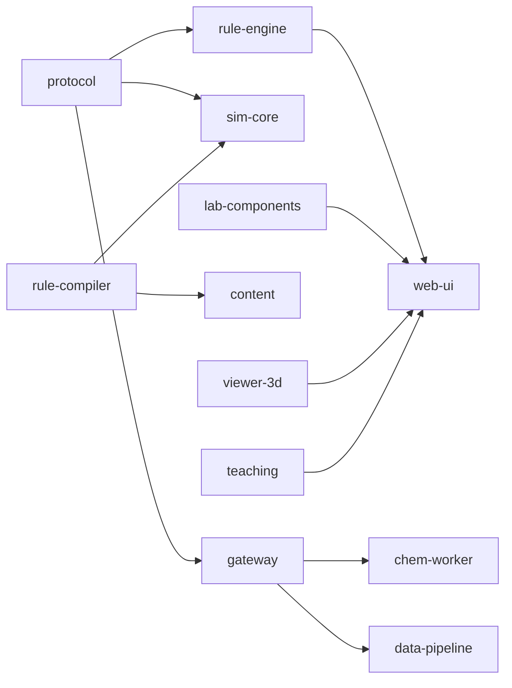

# 05 · 工程结构与路径

> 目标：把「先全局后局部、先复用后创造、长期可维护、全局总成本最低」落到**具体的目录、包、命令与流程**。
> 本阶段只定结构与规范，不写实现代码。

## 一、仓库形态：pnpm Monorepo

**判断依据**：前端（TS）、仿真核心（Rust→WASM）、化学计算（Python）、内容数据（JSON/YAML）四种工具链必须共存，但共享同一套「规则 schema / 器材参数表 / 资产」。pnpm workspace 是成本最低的组织方式（不引入 Nx/Turbo 等额外编排器，除非 M2 出现构建瓶颈）。

```
open-chem-lab/
├── CHARTER.md  README.md  CREDITS.md  LICENSE
├── CONTRIBUTING.md  SECURITY.md  CHANGELOG.md
├── package.json  pnpm-workspace.yaml  pnpm-lock.yaml
├── .github/ (workflows / ISSUE_TEMPLATE / PULL_REQUEST_TEMPLATE)
├── docs/ (本阶段交付物)
├── schemas/                       # JSON Schema 单一事实源
│   ├── compound.schema.json
│   ├── substance.schema.json
│   ├── material.schema.json
│   ├── apparatus.schema.json
│   ├── reaction-rule.schema.json
│   ├── phenomenon.schema.json
│   └── save.schema.json
├── content/                       # 人工精校内容层（本项目核心自研资产）
│   ├── rules/                     # YAML 规则，按主题分目录
│   │   ├── acid-base/  precipitation/  redox/  combustion/
│   │   ├── electrolysis/  gas-generation/  thermo/  organic-basic/
│   │   └── _index.yaml            # 规则清单 + 校验元数据
│   ├── materials/  apparatus/  compounds-seed/
│   ├── experiments/               # 教材同步实验模板（M3）
│   └── golden-cases/              # CI 黄金用例集（教材代表实验）
├── packages/
│   ├── sim-core/                  # Rust→WASM（fork Sandspiel crate 改造）
│   │   ├── Cargo.toml  src/{lib.rs,material.rs,grid.rs,physics.rs,rules.rs}
│   │   └── pkg/ (wasm-pack 产物，不入库)
│   ├── rule-engine/               # TS：条件匹配 / 现象编排 / 置信度
│   ├── rule-compiler/             # TS/Python：content → 二进制规则包
│   ├── protocol/                  # TS：现象指令协议 / 存档格式 / 类型
│   ├── web-ui/                    # React + Vite：双视图 / 编辑器 / 图鉴 / 报告
│   ├── viewer-3d/                 # R3F + 程序化 3D 器材 + 3Dmol.js 封装
│   ├── lab-components/            # open-lab-components 薄包装
│   ├── gateway/                   # Node/Fastify 或 Rust/axum：REST + WS + 鉴权
│   ├── chem-worker/               # Python：RDKit/Cantera/CoolProp
│   ├── data-pipeline/             # Python：PubChem/ORD 导入与 ORDerly 清洗
│   ├── teaching/                  # M3：教材/纠错/报告/测评/LTI/xAPI
│   └── shared/                    # i18n / 常量 / 工具
├── tools/asset-pipeline/          # 美术资产转换（见 design/04）
├── assets/                        # 资产产物 + attribution/
├── deploy/
│   ├── docker-compose.yml
│   ├── docker-compose.minimal.yml # 单机 4C8G 最小部署
│   ├── Dockerfile.*  Caddyfile
│   └── .env.example
├── data-ord/                      # 【独立仓库/子模块】CC-BY-SA 数据，不并入主代码仓
└── tests/ (e2e / golden-cases / license-scan)
```

> **关键路径决策**：`data-ord/` 必须是**独立 Git 仓库或 submodule**，与主代码仓物理分离（CC-BY-SA 隔离，ADR-0005）。`content/` 是我们自己精校的规则，与 ORD 衍生规则分目录存放，避免许可证混同。

## 二、包职责与依赖方向



**依赖规则（CI 强制）**：
- `protocol` 是最底层，**不依赖任何包**；避免循环依赖。
- `sim-core`（Rust）与 `rule-engine`（TS）通过 `protocol` 的二进制/JSON 契约通信，互不 import。
- `web-ui` 不直接调 RDKit/Cantera，一律经 `gateway`。
- 任何包不得 import GPL/AGPL 依赖（CI 许可证扫描）。
- `content/` 是数据，不被代码 import（由 `rule-compiler` 编译成产物）。

## 三、技术栈锁定（宽松许可，长期可维护）

| 层 | 选型 | 版本策略 | 理由 |
|---|---|---|---|
| 语言 | TypeScript 5.x（前端/网关）、Rust（sim-core）、Python 3.11+（化学计算） | 锁定 major | 全栈统一、WASM 与化学库生态最佳 |
| 包管理 | pnpm workspace / Cargo / uv 或 Poetry | lockfile 入库 | 可复现构建 |
| 前端 | React 18/19 + Vite + Zustand + PixiJS(2D) + R3F/Three.js(3D) | 固定 minor | 成熟、宽松许可 |
| 化学结构 | Kekule.js / SmilesDrawer / RDKit.js（按需懒加载） | 固定版本 | 不重复造轮子 |
| 分子 3D | 3Dmol.js（BSD-3） | 固定版本 | 论文引用要求写进 About |
| WASM 构建 | `wasm-pack` + `wasm-bindgen` | Rust toolchain 固定 | Sandspiel 现成链路 |
| 网关 | Fastify(Node) 或 axum(Rust) | M0 二选一 | 无状态、WS 支持好 |
| 化学计算 | RDKit + Cantera(待核) + CoolProp/thermo/chemicals | 固定版本 | 全宽松许可 |
| 数据库 | PostgreSQL + RDKit Cartridge | 固定镜像 tag | 子结构检索进库，少一个组件 |
| 缓存/队列 | Redis + PG 队列表 | — | 不引入 Kafka |
| 对象存储 | MinIO 或本地卷 | 最小部署用本地卷 | 自托管友好 |
| 教学标准 | ltijs (Apache-2.0) / xAPI | M3 | 校园平台对接 |
| 测试 | Vitest / Playwright / pytest / cargo test | — | 见下 |
| CI | GitHub Actions | — | 见下 |

> **刻意不引入**：Neo4j、Kafka、Elasticsearch、Kubernetes、独立 ML 服务、Nx/Turbo。理由：单机 4C8G 自托管是硬门槛，每多一个组件都增加部署与运维成本（全局总成本最低）。

## 四、开发与提交规范

| 项 | 规范 |
|---|---|
| 分支 | `main` 受保护；功能分支 `feat/*`、`fix/*`、`docs/*`、`content/*`；发布 `tag v0.x.0` |
| 提交 | Conventional Commits（`feat(rule): …` / `fix(sim): …` / `docs: …` / `content: …`） |
| 规则变更 | 必须走 `content/rules/` + `rule_revision`，PR 附来源与置信度，CI 跑黄金用例 |
| 变更宪章/架构 | 必须先提交 ADR，再改代码；PR 模板强制勾选「是否需要 ADR」 |
| 版本号 | 语义化；`ruleset-core-YYYY.MM.DD` 单独版本化内容包 |
| 代码风格 | TS/Rust/Python 各自官方 formatter + lint，CI 门禁 |
| 文档 | 简体中文；事实须带来源；推测标注「判断 / 待验证」 |

### CI 门禁（GitHub Actions）

| 检查 | 触发 | 作用 |
|---|---|---|
| `license-scan` | 每次 PR | 依赖许可证白名单（MIT/BSD/Apache/ISC/CC0/CC-BY），**发现 GPL/AGPL 直接失败** |
| `schema-validate` | 每次 PR | `ajv` 校验 `content/` 全部 YAML/JSON |
| `golden-cases` | 每次 PR | 教材代表实验断言（中和、制氧、置换、沉淀、电解…），防改错规则 |
| `rule-lint` | 每次 PR | 计量守恒、条件互斥、置信度闸门、来源完整性 |
| `asset-attribution` | 每次 PR | 每个 `assets/` 文件在 `ASSETS.csv` 有记录 |
| `build` | 每次 PR | pnpm build + wasm-pack build + Docker 镜像构建 |
| `e2e` | main + 发布前 | Playwright 跑 8 个错误操作场景与存档分享 |
| `link-check` | 每周 | 文档内部链接有效性 |

## 五、路径决策表（把「预料中的问题」提前定死）

| 问题 | 决策 | 理由 |
|---|---|---|
| 单体仓库还是多仓？ | 主代码 monorepo + **ORD 数据独立仓** | 共享 schema/资产；CC-BY-SA 物理隔离 |
| 前端框架？ | React | 生态最大，R3F/Kekule-React/open-lab-components 都有封装 |
| 网关语言？ | M0 在 Fastify(Node) 与 axum(Rust) 间实测二选一 | 先验证再锁定，避免凭偏好决策 |
| 仿真核心为何不纯 JS？ | Rust→WASM | 60fps 网格 + 已有 Sandspiel 现成链路；纯 JS 难达标 |
| 反应规则放哪？ | `content/` 数据 → 编译成二进制下发 | 不硬编码进 WASM（ADR-0006） |
| 3D 器材从哪来？ | 程序化生成 | 无 CC0 现成模型（ADR-0007） |
| 为何不用 The Powder Toy 代码？ | GPL-3.0，只参考 | 链接即传染（ADR-0005） |
| 为何不用 PhET 单 HTML？ | GPL，仅独立页面原样自托管 | 同上 |
| 多人协作怎么做？ | Yjs 自研（MIT） | 避开 tptmp AGPL |
| 子结构检索怎么做？ | PG + RDKit Cartridge | 不引入图数据库/搜索引擎 |
| 冷路径任务队列？ | PG 队列表 + Redis | 不引入 Kafka，单机可跑 |
| 教材模板文案从哪来？ | 自行编写 + 开放教材参考，**不复制 NB 模板** | 合规（`CHARTER` 第 5 条 / 对标边界） |
| 账号体系？ | 自托管本地账号 + 可选 OIDC/LTI | 无云依赖；学校数据不出校 |
| 移动端？ | 响应式 Web（PWA），不做原生 App | 纯 Web 决策（D2）的自然结果 |
| 离线？ | Service Worker + IndexedDB 缓存前端与规则包 | 断网可玩（硬要求） |

## 六、M0 验证清单（写产品代码前必须消掉的不确定性）

| # | 验证 | 命令/动作 | 通过标准 |
|---|---|---|---|
| 1 | Sandspiel 基座 | `cd crate && wasm-pack build && npm i && npm run start`；改 `species.rs` 加一个元素 | 浏览器能喷洒自定义物质并产生一种反应 |
| 2 | 规则数据驱动可行性 | 在 fork 里把 1 条反应改成查表 | 不重编译即可改反应行为（或确认需重编译，评估可接受度） |
| 3 | 化学层 | `pip install rdkit`，`ReactionFromSmarts()` 跑中和模板 | 产物正确 |
| 4 | RDKit.js WASM | `npm i @rdkit/rdkit`，测体积与首次加载 | 体积可接受、可按需懒加载 |
| 5 | ORD 解析 | `GIT_LFS_SKIP_SMUDGE=1 git clone ord-data` + HuggingFace 脚本取 1 个小数据集，`ORDerly` 解析一条 | 能读出反应式与条件 |
| 6 | tikz 转换 | 用 `texlive` 镜像编译 `\tkzTitration` → dvisvgm → SVG | SVG 可显示、字体无外部依赖 |
| 7 | 组件挂载 | `npm i @itkdm/open-lab-components` + 包装组件 | StrictMode 下无重复 DOM |
| 8 | Cantera 许可证 | 打开仓库 LICENSE 与官网 | 确认 BSD-3 或明确替代方案 |
| 9 | Kenney 许可 | 下载资产包读 LICENSE | 确认 CC0 1.0 |
| 10 | 最小部署 | 起 `postgres + redis + gateway + web` 四个容器 | 4C8G 单机可跑 |

> 这 10 项各半天以内，全部属**阶段二（验证与骨架）**，本阶段（规划与设计）只把它们定义清楚。

## 七、长期可维护性设计

1. **契约先行**：`schemas/` + `protocol` 是唯一事实源，各语言生成类型（TS 用 `json-schema-to-ts`，Rust 用 `serde`，Python 用 pydantic）。
2. **内容即数据**：规则、器材、实验模板都是可 review 的文本，非代码；支持 diff、回滚、社区 PR。
3. **可重放**：存档带 `ruleset_version`，任何历史存档都能解释。
4. **可替换**：现象指令协议让渲染器、求解器、前端可独立替换（例如换 WebGPU 渲染、换求解库）。
5. **可审计**：每条规则带来源与置信度，CI 跑黄金用例，防止内容回归。
6. **无供应商锁定**：全自托管、开放格式、无第三方云依赖、无会员墙。
