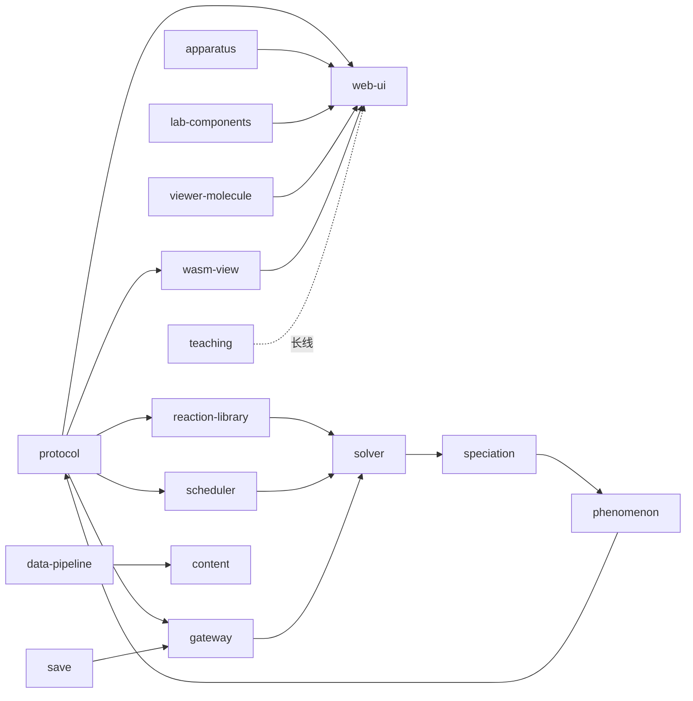

# 05 · 工程结构与路径

> 目标：把「先全局后局部、先复用后创造、长期可维护、全局总成本最低」落到**具体的目录、包、命令与流程**。
> 依据：[决策台账](../11-问题与决策台账.md) 4.2 / 6.1 / 9.1 / 9.4 / 10.1 / 10.4；关联 ADR-0003、0005、0006、0008。
> 本阶段只定结构与规范，不写实现代码。**v2.0**：删除落沙 fork、离线规则包、Yjs、教学层主链、monorepo 内 `data-ord/`。

## 一、仓库形态：pnpm Monorepo

**判断依据**：前端（TS）、数值求解（Python / C++ 动态链接库）、内容数据（JSON/YAML）三种工具链必须共存，但共享同一套「参数 schema / 器材参数表 / 资产」。pnpm workspace 是成本最低的组织方式（不引入 Nx/Turbo 等额外编排器，除非 M2 出现构建瓶颈）。

```
open-chem-lab/
├── CHARTER.md  README.md  CREDITS.md  CHANGELOG.md
├── LICENSE  LICENSE.GPL-3  LICENSE.LGPL-3  NOTICE
├── CONTRIBUTING.md  SECURITY.md  .gitattributes  .gitignore
├── package.json  pnpm-workspace.yaml  pnpm-lock.yaml
├── .github/ (workflows / ISSUE_TEMPLATE / PULL_REQUEST_TEMPLATE)
├── docs/ (本阶段交付物；11-问题与决策台账.md 为唯一事实源)
├── schemas/                       # JSON Schema 单一事实源
│   ├── compound.schema.json
│   ├── apparatus.schema.json
│   ├── reaction-rule.schema.json
│   ├── solution-speciation.schema.json
│   ├── speciation-timeline.schema.json
│   ├── phenomenon.schema.json
│   └── save.schema.json
├── content/                       # 人工精校真实反应库（本项目核心自研资产）
│   ├── rules/                     # YAML 参数，按体系分目录
│   │   ├── acid-base/  precipitation/  redox/  combustion/
│   │   ├── electrolysis/  gas-generation/  thermo/  hydrolysis/
│   │   ├── complexation/  organic-basic/  and _index.yaml
│   ├── compounds/  apparatus/
│   ├── curriculum/                # 课标知识点映射 + 多版本教材标注（长线）
│   ├── golden-cases/              # CI 黄金用例集（数值零错断言）
│   └── ai-crosscheck/             # AI 独立对拍记录（ChemPy / Cantera）
├── packages/
│   ├── protocol/                  # TS：st.phenomenon.v1 / 存档 / 时间轴 / 类型
│   ├── solver/                    # Python：动态定量求解（CVODES / SciPy / ChemPy /
│   │                              #   pyequion2 / Cantera / Reaktoro 动态链接）
│   ├── scheduler/                 # TS/Python：SP-1 关注度分数、帧预算配额、事件唤醒
│   ├── speciation/                # 物种分布 / 时间轴快照
│   ├── reaction-library/          # 静态参数加载、校验、rule_revision
│   ├── phenomenon/                # 现象注册表与指令编排
│   ├── apparatus/                 # 实验台器材逻辑 + 2D 写实资产绑定
│   ├── wasm-view/                 # Rust→WASM：容器内现象即时渲染（固定 60fps）
│   ├── lab-components/            # open-lab-components 薄包装（辅资产）
│   ├── viewer-molecule/           # 3Dmol.js 分子/晶体视图封装
│   ├── web-ui/                    # React + Vite：实验台 / 物种面板 / 微观视图 / 时间轴 / 图鉴
│   ├── gateway/                   # Node/Fastify 或 Rust/axum：REST + WS + 鉴权
│   ├── save/                      # 轻量存档 + 关键快照回放
│   ├── data-pipeline/             # Python：权威源导入 / ORD 事实抽取（离线）
│   ├── teaching/                  # 【长线】课标映射与教学附加内容，不进 M1–M3
│   └── shared/                    # i18n / 常量 / 工具
├── tools/asset-pipeline/          # 美术资产转换（见 design/04）
├── assets/                        # 资产产物 + attribution/
├── deploy/
│   ├── docker-compose.yml
│   ├── docker-compose.minimal.yml
│   ├── Dockerfile.*  Caddyfile
│   ├── .env.example
│   └── README-windows.md          # WSL2 / Docker Desktop 双平台说明
└── tests/ (e2e / golden-cases / license-scan / lgpl-link-check)
```

> **关键路径决策**：
> - `data-ord/` **不在本仓库目录树内**，而是**独立公开 Git 仓库**，主仓仅以 submodule 引用（台账 10.4 / M4 销项）。CC-BY-SA 数据与 LGPL-3.0 代码物理分离。
> - `content/` 是自有精校参数，与 ORD 衍生规则分目录存放，避免许可证混同。
> - 全仓路径**统一小写 + snake_case**，`.gitattributes` 强制 LF（Win + Linux 双平台硬约束）。
> - **不存在** `sim-core`（Sandspiel fork）、`rule-compiler`（二进制规则包）、Service Worker / IndexedDB / 离线规则包、Yjs 相关包。

## 二、包职责与依赖方向



**依赖规则（CI 强制）**：

- `protocol` 是最底层，**不依赖任何包**；避免循环依赖。
- `solver`（Python）与 `wasm-view`（Rust）通过 `protocol` 的 JSON 契约通信，互不 import。
- `web-ui` 不直接调求解库，一律经 `gateway`。
- 任何包不得 import AGPL / GPLv2-only 依赖（CI 许可证扫描）；GPL-3.0 组件依选型决策不纳入。
- `content/` 是数据，不被代码 import（由 `reaction-library` 运行时加载）。
- **Reaktoro 以动态链接、运行时可替换形态接入**，不把 C++ 源码静态编入主二进制（`lgpl-link-check` 校验）。

## 三、技术栈锁定（许可证兼容，长期可维护）

| 层 | 选型 | 版本策略 | 理由 |
|---|---|---|---|
| 语言 | TypeScript 5.x（前端/网关）、Rust（wasm-view）、Python 3.11+（solver） | 锁定 major | 各自生态最佳 |
| 包管理 | pnpm workspace / Cargo / uv 或 Poetry | lockfile 入库 | 可复现构建 |
| 前端 | React + Vite + Zustand + PixiJS（容器内现象） | 固定 minor | 成熟、宽松许可 |
| **定量求解** | **SUNDIALS CVODES / SciPy / ChemPy / pyequion2 / Cantera / Reaktoro(动态链接)** | 固定版本 | 全部复用成熟开源，不造轮子；全链与 LGPL-3.0 兼容 |
| 化学结构 | RDKit / Kekule.js / SmilesDrawer / RDKit.js（按需懒加载） | 固定版本 | 辅助解析与绘制 |
| 分子 3D | 3Dmol.js（BSD-3，M0 复核） | 固定版本 | 唯一 3D 用途；论文引用写进 About |
| WASM 构建 | `wasm-pack` + `wasm-bindgen` | Rust toolchain 固定 | 容器内现象渲染 |
| 网关 | Fastify(Node) 或 axum(Rust) | M0 二选一 | 无状态、WS 支持好 |
| 数据库 | PostgreSQL（+ 可选 RDKit Cartridge） | 固定镜像 tag | 少一个组件 |
| 缓存 | Redis | — | 不引入 Kafka |
| 对象存储 | MinIO 或本地卷 | 最小部署用本地卷 | 自托管友好 |
| 教学标准 | ltijs / xAPI / H5P | **长线** | 不进 M1–M3 |
| 测试 | Vitest / Playwright / pytest / cargo test | — | 见下 |
| CI | GitHub Actions | — | 见下 |

> **刻意不引入**：Neo4j、Kafka、Elasticsearch、Kubernetes、独立 ML 服务、Nx/Turbo、Yjs、Service Worker / IndexedDB。理由：单机自托管是硬门槛，每多一个组件都增加部署与运维成本（全局总成本最低）。

## 四、开发与提交规范

| 项 | 规范 |
|---|---|
| 分支 | `main` 受保护；功能分支 `feat/*`、`fix/*`、`docs/*`、`content/*`；发布 `tag v0.x.0` |
| 提交 | Conventional Commits（`feat(rule): …` / `fix(solver): …` / `docs: …` / `content: …`） |
| 参数变更 | 必须走 `content/rules/` + `rule_revision` + AI 对拍记录 + 用户签核，CI 跑黄金用例 |
| 变更宪章 / 架构 | 必须先提交 ADR，再改代码；PR 模板强制勾选「是否需要 ADR」「关联台账条目」 |
| 版本号 | 语义化；`ruleset-core-YYYY.MM.DD` 单独版本化内容包 |
| 代码风格 | TS / Rust / Python 各自官方 formatter + lint，CI 门禁 |
| 文档 | 简体中文；事实须带一级来源；推测标注「判断 / 待 M0 验证」；star 标快照日期 |
| 换行 | `.gitattributes` 强制 LF；禁止 CRLF 入库 |

### CI 门禁（GitHub Actions）

| 检查 | 触发 | 作用 |
|---|---|---|
| `license-scan` | 每次 PR | 白名单 MIT / BSD / Apache-2.0 / ISC / CC0 / CC-BY / **LGPL-2.1 / LGPL-3.0**；**AGPL / GPLv2-only 直接失败**；GPL-3.0 组件出现即要求 ADR |
| `lgpl-link-check` | 每次 PR | 校验 LGPL 库动态链接 + 可替换 + 显著声明 + 许可证全文（§4/§6 义务） |
| `docs-and-compliance` | 每次 PR | 内部链接、核心文档与台账存在、LGPL 双文本、无明文 token、无 tikz 宏包源码 |
| `schema-validate` | 每次 PR | `ajv` 校验 `content/` 全部 YAML/JSON |
| `golden-cases` | 每次 PR | **数值零错**断言：中和、制氧、置换、沉淀、电解、弱酸电离、水解、缓冲、络合… |
| `rule-lint` | 每次 PR | 计量守恒、条件互斥、置信度闸门、来源 / 对拍 / 签核完整性、适用条件完整性 |
| `asset-attribution` | 每次 PR | 每个 `assets/` 文件在 `ASSETS.csv` 有记录 |
| `build` | 每次 PR | pnpm build + wasm-pack + Docker 镜像构建 |
| `e2e` | main + 发布前 | Playwright 跑实验台全链路、错误操作场景、时间轴回放 |
| `dual-platform` | M0 起 | Windows 与 Linux 各跑一次最小部署与资产转换 |
| `link-check` | 每周 | 文档内部链接有效性 |

## 五、路径决策表（把「预料中的问题」提前定死，v2.0 全表重写）

| 问题 | 决策 | 依据 |
|---|---|---|
| 单体仓库还是多仓？ | 主代码 monorepo + **ORD 数据独立公开仓** | CC-BY-SA 物理隔离（10.4） |
| 主视图？ | **实验台唯一视图**，无无限画布 / 双视图 | 台账 5.1 / 6.1 |
| 定量求解放哪？ | **服务端常驻 worker**，前后端缺一不可 | 台账 3.1 / 4.2 |
| 离线还能玩吗？ | **不能**，废弃断网可玩；删除 SW / IndexedDB / 离线规则包 | 台账 4.2（C1/C8 销项） |
| WASM 做什么？ | 只做**容器内现象即时渲染 + 求解加速** | 台账 6.1 |
| 反应与参数放哪？ | `content/` 数据 → 服务端运行时加载，**不编译进 WASM** | ADR-0006 |
| 快 / 慢反应怎么分？ | 由 **CVODES 数值刚性自动判定**，不设人为阈值 | SP-1 / C3 |
| 算力怎么分配？ | **关注度分数 + 16.7ms 帧预算动态配额** | ADR-0008 |
| 3D 器材从哪来？ | **不做**（3D 只做分子 / 晶体）；程序化 3D 器材降级长线 | 台账 6.3 |
| 美术主调？ | **出版级写实 2D**，tikz-chemlab 主 / open-lab-components 辅 | 台账 5.3 |
| 为何不用 The Powder Toy / PhET / H5P 代码？ | 换 LGPL 后许可证层面兼容，但**依选型决策不纳入**，只读参考 | 台账 6.2 |
| 为何不用 tptmp？ | AGPL 严格不兼容，完全隔离 | 【补正 B】B6 |
| Reaktoro 怎么接？ | **动态链接 + 运行时可替换 + §6 义务清单** | 【补正 A】 |
| 多人协作怎么做？ | **不做**；单人 + AI 体制，轻量存档 + 关键快照时间轴 | 台账 9.4（C29） |
| 教学层何时做？ | **保留愿景 · 后置长线**（M4），不进 M1–M3 | 台账 9.2 / 10.1 |
| 内容怎么组织？ | 按**课标知识点** + 多版本教材标注；不内置教学功能 | 台账 9.3 |
| 子结构检索怎么做？ | PG + 可选 RDKit Cartridge；不引入图数据库 / 搜索引擎 | 全局总成本最低 |
| 任务队列？ | PG 队列表 + Redis；不引入 Kafka | 同上 |
| 教材文案从哪来？ | 自行编写 + 开放教材参考，**不复制 NB 模板 / 素材 / 界面 / 商标** | 对标边界 |
| 移动端？ | 响应式 Web；**不做 PWA 离线** | 废弃断网（4.2） |
| 部署形态？ | 前后端常驻；单机 / 多机 / 公共 Demo **延后到阶段二** | 台账 9.1 |
| 双平台怎么保？ | `.gitattributes` LF、路径小写、卷挂载 / 端口可配、M0 双平台验证 | 台账 9.1（C28） |
| 网关语言？ | M0 在 Fastify(Node) 与 axum(Rust) 实测二选一 | 先验证再锁定 |
| 账号体系？ | 自托管本地账号；无云依赖 | 自托管友好 |

## 六、M0 验证清单（进入阶段二前必须消掉的不确定性）

| # | 验证 | 通过标准 |
|---|---|---|
| 1 | **双平台最小部署** | Windows（WSL2 / Docker Desktop）与 Linux 各起一次 `web + gateway + solver-worker + postgres`，均可访问 |
| 2 | 定量求解链路 | CVODES / ChemPy / Cantera / pyequion2 / Reaktoro（动态链接）在中和、弱酸电离、水解、沉淀四体系跑通，数值与权威源一致 |
| 3 | AI 对拍可行性 | ChemPy / Cantera 独立复算与人工签核流程跑通一条参数，黄金用例进 CI |
| 4 | 容器内 WASM 现象渲染 | 固定 60fps；求解快照异步喂入 + 插值平滑不卡顿 |
| 5 | tikz-chemlab 输出物转译 | `\tkzTitration` → SVG 可显示、字体无外部依赖、液位 `clipPath` 可控；宏包源码不入库 |
| 6 | open-lab-components 包装组件 | StrictMode 下无重复 DOM；写实主调兼容性评估 |
| 7 | 3Dmol.js 许可证与论文 DOI | 确认 BSD-3 并登记引用文本（F2） |
| 8 | Kenney 包内 LICENSE | 确认 CC0 1.0（仅取通用音效 / 粒子贴图） |
| 9 | LGPL 动态链接 / 可替换 | 运行时替换 Reaktoro 版本成功；`lgpl-link-check` 通过 |
| 10 | CI 全套门禁 | 许可证白名单、schema、黄金用例、署名、双文本、无 token 全部通过 |

> M0 不写产品代码，只消解不确定性；任何一项失败，先修订对应 ADR 再继续。**不设时间预算，以质量闸门为准**（台账 1.1）。

## 七、长期可维护性设计

1. **契约先行**：`schemas/` + `protocol` 是唯一事实源，各语言生成类型（TS 用 `json-schema-to-ts`，Rust 用 `serde`，Python 用 pydantic）。
2. **内容即数据**：参数、器材、知识点映射都是可 review 的文本，非代码；支持 diff、回滚、AI 对拍与人工签核。
3. **可重放**：存档带 `ruleset_version`，任何历史存档都能解释；只存关键快照 + 增量事件。
4. **可替换**：现象指令协议让渲染器、求解器、前端可独立替换；Reaktoro 运行时可换版本。
5. **可审计**：每条参数带来源 / 置信度 / 对拍记录 / 签核人，CI 跑黄金用例防止内容回归。
6. **无供应商锁定**：全自托管、开放格式、无会员墙、前后端常驻本地服务器。
7. **双平台一等公民**：Windows 与 Linux 在 CI 中同等验证，避免「只在 Linux 上能跑」。
