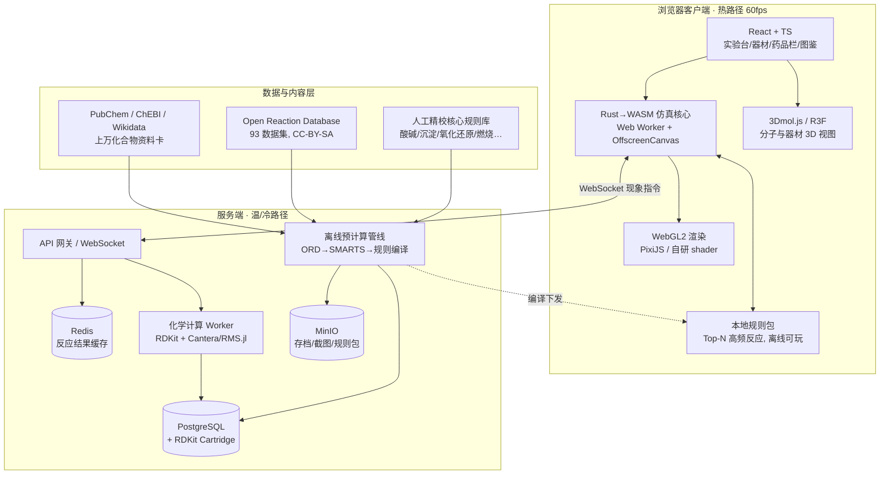
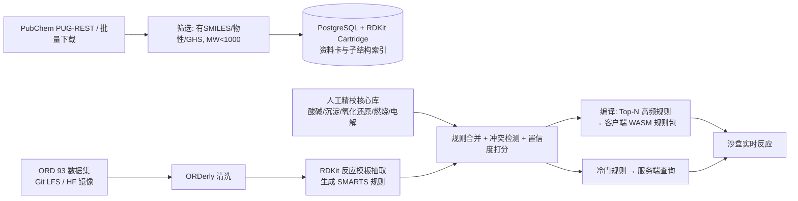

# 开源「超自由仿真化学实验室」调研与二次开发方案

> ⚠️ **历史归档 · 整体作废（不作现行设计依据）**
> 本文写于决策收口之前。开篇的「已确认四项决策」以及沙盒 / 落沙 / 断网可玩 / 自定义物质 / 社区工坊 / 周月工期等口径，**已被 `docs/11-问题与决策台账.md` 全部推翻**。
> 现行设计以台账为唯一事实源；逐条作废对照见 [`docs/research/data/README.md`](README.md)。以下内容仅作检索证据与决策溯源留存，**原文未改动**。

> 检索日期：2026-11-13 ~ 11-14 · 方法：多引擎聚合检索（必应中国/国际、百度、360、搜狗、GitHub 垂直站）+ GitHub API 精确核实 + 打开 README/官网原文二次核实
> 目标：在自己服务器上部署一个**无限制的超自由仿真化学实验室**，既是沙盒游戏，也能作为各学段化学教具，对标 NB实验室 的核心玩法
> 已确认的四项决策：**混合分层仿真 / Web 端（允许后端重计算，性能优先）/ 先做沙盒好玩 / 全量上万物质与反应**

---

## 一、结论先行

**不存在符合要求的可直接部署的开源单体项目。** 证据来自 GitHub API 精确检索（按 star 排序）：

| 检索式 | 结果总数 | 最高 star 项目 | 判断 |
|---|---|---|---|
| `"virtual chemistry lab"` | 179 | model-chemlab ★102（**闭源**） | 无成熟项目 |
| `"chemistry lab simulator"` | 39 | nsriram/chem_lab ★31 | 课程作业级 |
| `"chemistry sandbox"` | 27 | atoms-md ★4 | 原型级 |
| `"chemistry sandbox game"` | 5 | Chemistry-Sandbox ★1 | 玩具级 |
| `"chemical reaction simulator"` | 102 | ReactionMechanismSimulator.jl ★97 | 数值计算库，非游戏 |

整体型产品（NB实验室、ChemCollective Virtual Lab、Model ChemLab、ChemBox Sandbox）**全部闭源**；成熟开源项目全部落在「零件层」：物理沙盒、落沙引擎、教学小仿真、化学信息学库、反应数据库、分子可视化。

所以答案是走你说的第二条路：**基于开源项目链做集成 + 二次开发**。好消息是零件层非常成熟且许可证友好，缺的只是把它们「串成一个产品」的胶水层与内容层 —— 这恰好是我们可以自己掌控的部分。

---

## 二、避坑清单（重要）

这几个项目在搜索里排名靠前，但**不能作为基座**，别浪费时间：

| 项目 | 表面 | 真相 |
|---|---|---|
| `XXX-Offline-69/model-chemlab` ★102 | README 写满"滴定/量热/重量分析/实验报告"，看着最像 NB | **不是开源**。其 License 明确：仅允许原样分发安装包，「repackaging / distributing modified binaries requires prior written permission」，仿真引擎与内容仍归原作者所有。且是 Windows 桌面程序、需要联网执行 PowerShell 安装脚本（有安全不确定性）。**不能二次开发、不能部署到服务器** |
| ChemCollective Virtual Lab | 卡内基梅隆大学经典虚拟实验室，器材/溶液/反应教学对口 | 多引擎检索**未找到任何官方源码或开源许可**，GitHub 上只有 4 个第三方小仓库（Moodle 过滤器、replica）。老 Java Applet 技术栈，判定闭源 |
| ChemBox Sandbox（chembox.agigui.com） | 浏览器版"混合元素发现反应"化学沙盒，观感接近目标 | 页面未给出源码/仓库/许可，功能也较浅（元素喷洒 + 反应列表），判定为闭源 Web Demo，仅可作交互参考 |
| The Powder Toy / PhET / tptmp | 成熟开源 | 见第六节：许可证是 GPL / AGPL，**不能直接链接进产品**，否则整体须开源 |

> 另外，NB实验室免费版本身开放约 20% 实验与 DIY 器材（官网价格页），PhET、The Powder Toy、ChemCollective、Sandspiel 在线版都免费 —— 这些可以**今天就玩**，用来在自研产品出来前解馋，见第九节 M0。

---

## 三、目标校准：先把「几万种物质、反应」这句话拆开

上一轮调研（见 `NB实验室功能调研报告.md`）核实过 NB 的官方口径：**化学单科近 200 个经典实验、1000+ DIY 器材、App 全学科 2000+ 教材同步实验、三大系统（速率/化学平衡/压强）**。它并不是一个"输入任意两种物质就自动算出产物"的通用反应预测器，而是**预置实验模板 + 引擎驱动的现象模拟**。

这其实是个好消息：NB 的核心玩法（自由取用器材药品、任意混合、错误操作后果可视化、现象即时反馈）用规则引擎就能复现，不需要量子化学。但你选了「全量上万物质 + 反应」，这意味着目标实际**高于 NB**，必须把概念分清楚，否则会做出一个既不好玩也不科学的四不像：

| 概念 | 含义 | 能否上万 | 获取方式 |
|---|---|---|---|
| **可查询化合物** | 有结构、物性、安全数据的资料卡 | ✅ 容易 | PubChem / ChEBI / Wikidata 批量导入 |
| **可参与反应的物质** | 有明确反应规则、能产生现象 | ⚠️ 难 | ORD 数据 + SMARTS 模板抽取 + 人工精校 |
| **表现型粒子** | 客户端 60fps 模拟的相态/颜色/沉淀/气体 | ❌ 只能几百种 | 规则引擎里的"表现材质"，与化合物库是多对一映射 |

**最关键的一条工程诚实**：在化学上，「任意两种物质混合会生成什么」是**不可判定**的 —— 取决于温度、浓度、溶剂、pH、压强、相态、催化剂、光照、反应时间甚至容器材质。任何声称"万能反应预测"的产品都在骗人。

因此本方案的设计是：**条件化规则 + 置信度 + 兜底语义**。命中规则才产生现象；没命中就明确返回「当前条件下未观察到明显变化」，并把该组合记入"未覆盖日志"用于后续补规则。这既科学，又给玩家留了探索空间（"换个条件再试试"），还形成了内容生产的数据飞轮。

---

## 四、总体架构（混合分层 + Web 端 + 后端重计算）



### 四层职责

| 层 | 位置 | 职责 | 性能要求 |
|---|---|---|---|
| **L0 表现层** | 浏览器 WASM | 粒子/流体/相变、热传导、压强、扩散、火焰、电流；把「现象指令」渲染成变色、气泡、沉淀、爆炸、结晶、烟雾、温度/pH 曲线 | 60fps，零网络往返 |
| **L1 化学逻辑层** | 客户端本地规则包 + 服务端 | 条件化规则匹配、化学计量、现象编排、置信度判定、兜底语义 | 热路径 < 1ms；温路径 < 20ms |
| **L2 数值计算层** | 服务端 Worker（异步） | RDKit SMARTS 反应模板匹配、Cantera/RMS.jl 动力学与平衡积分、热力学估算、首次组合求解 | 秒级可接受，结果回写缓存 |
| **L3 数据层** | 服务端 | 上万化合物资料卡、反应规则库、器材库、用户存档、未覆盖日志 | 子结构检索走 RDKit Cartridge 索引 |
| **横切：教学层** | 两端 | 教材同步实验模板、分步指导与纠错、实验报告、操作测评、教师端 | 第二阶段 |

### 为什么这样分层能同时满足「上万物质」和「好玩」

- **好玩**由 L0 决定，只依赖几百种表现型粒子和本地规则包，和网络、数据库规模完全解耦 —— 断网也能玩。
- **上万物质**由 L3 承载，绝大多数以「资料卡 + 结构可视化」形式存在，只有被规则覆盖的子集能进沙盒反应。
- **性能最佳**：热路径全在客户端 WASM，温路径走 Redis 缓存，只有真正的新组合才落到 Python 化学计算 worker，且算完永久缓存。

---

## 五、开源项目链（可直接复用的零件）

按 github-gem-seeker 的质量标准（star / 最近提交 / 文档 / 许可证）筛选。**数据来自本轮 GitHub API 与 README 原文核实**；标「未核实」的项在 fork 前请再看一眼 LICENSE 文件。

### A 组：直接集成（宽松许可，主力）

| 项目 | 许可 | 指标 | 用途 | 集成方式 |
|---|---|---|---|---|
| [RDKit](https://github.com/rdkit/rdkit) | **BSD-3** | C++/Python，官方含 emscripten JS 包装、PostgreSQL cartridge | 分子解析、SMARTS 反应模板、子结构检索、描述符、2D 绘制 | 服务端 Python；Cartridge 装进 PostgreSQL 做上万物质检索；MinimalLib/WASM 可放前端 |
| [Sandspiel](https://github.com/MaxBittker/sandspiel) | MIT（第三方资料，需复核） | Rust→WASM + WebGL + JS | **L0 落沙/粒子引擎的架构原型** | fork `crate/`，把元素定义改成「物质 + 反应规则表」；README 明确其目标是支持可编程自定义元素 API，正合用 |
| [3Dmol.js](https://github.com/3dmol/3Dmol.js) | **BSD** | WebGL，支持 pdb/sdf/mol2/xyz/cif 等 | 分子/晶体 3D 可视化、微观过程展示 | 网页嵌入，做「物质资料卡」和微观视图 |
| [React Three Fiber](https://github.com/pmndrs/react-three-fiber) | MIT | ★33.7k，活跃 | 3D 实验器材与实验台 | 与 React 前端同栈 |
| [Open Reaction Database ord-schema](https://github.com/open-reaction-database/ord-schema) | **Apache-2.0** | ★117，2026-11 活跃 | 反应数据的结构化 schema | 作为内部反应规则表的设计参考 |
| [ORDerly](https://github.com/sustainable-processes/ORDerly) | **MIT** | ★127 | ORD 数据抽取与清洗、反应模板基准 | 离线管线：ORD → 清洗 → SMARTS 模板 |
| [ReactionMechanismSimulator.jl](https://github.com/ReactionMechanismGenerator/ReactionMechanismSimulator.jl) | **MIT** | ★97，2026-11 活跃 | 大规模化学动力学机理数值模拟 | L2 冷路径可选求解器 |
| [VChemLab](https://github.com/sdeepak-dev/vchemlab) | **MIT** | 纯静态零依赖，40 个引导实验 / 20 件器材 / 118 元素 / 测验与进度 | **教学层原型与内容结构参考** | 借鉴其实验模板、器材说明、测验的数据结构；代码可直接嵌入 |
| [reactagrid](https://github.com/FranekJemiolo/reactagrid) | MIT | ★1，TypeScript 落沙 + 真实化学数据 | 概念验证参考（化学数据驱动落沙） | 只读参考，不作依赖 |

### B 组：参考借鉴，**不要链接进产品**（许可证红线）

| 项目 | 许可 | 指标 | 借鉴什么 | 为什么不能直接集成 |
|---|---|---|---|---|
| [The Powder Toy](https://github.com/The-Powder-Toy/The-Powder-Toy) | **GPL-3.0** | ★5407，C++/SDL，2026-11 活跃 | 元素反应矩阵、热/压/电/相变耦合、Lua 自定义元素、上千社区存档的「工坊」形态 | 链接即触发 GPL，整个产品必须开源 |
| [tptmp](https://github.com/The-Powder-Toy/tptmp) | **AGPL-3.0** | ★43，Lua，多人脚本 | 多人协作的同步思路 | AGPL 传染性更强（网络使用即视为分发） |
| [PhET](https://github.com/phetsims) | **GPL**（官方源码页明确「定制现有 sim 须遵守 GPL」） | 每个 sim 是自包含单 HTML，可离线自托管 | 化学小仿真的教学设计（配平方程式、反应速率、酸碱溶液等） | 可在**独立页面/独立进程**里原样自托管使用，不要合并进主代码库 |

### C 组：数据（注意 CC-BY-SA 的隔离）

| 数据源 | 许可/性质 | 规模 | 用途 |
|---|---|---|---|
| [PubChem](https://pubchem.ncbi.nlm.nih.gov) | NIH 免费公开，PUG-REST + 批量下载 | 第三方快照站称已收录超 1.2 亿化合物记录（量级参考，官方表述为「世界最大免费化学数据库」） | 上万化合物资料卡：结构、物性、GHS 安全数据 |
| [Open Reaction Database ord-data](https://github.com/open-reaction-database/ord-data) | **CC-BY-SA-4.0** | ★352，2026-11 活跃；browse 页显示 93 个数据集；Git LFS 存储，另有 Hugging Face 镜像 | 反应生成规则的主要来源（以有机反应为主） |
| ChEBI / Wikidata 化学条目 | 开放数据 | 未本轮核实 | 中文名、别名、分类、用途等的补充 |

> **合规建议**：把「数据」与「代码/规则」分仓存放；ORD 衍生的规则表单独署名并保留 CC-BY-SA 声明，主产品代码用 MIT/Apache；只保留事实性反应式与条件，避免把带 SA 的表述整段复制进闭源规则文件。真要做商业产品前，建议找法务确认一次数据衍生品的边界。

---

## 六、许可证合规红线（必须先定，否则后期推倒重来）

1. **主链只用宽松许可**：MIT / BSD-3 / Apache-2.0 / PostgreSQL / 自有代码。这样产品可以闭源、可以商用、可以换许可证。
2. **GPL/AGPL 组件物理隔离**：The Powder Toy、tptmp、PhET 只作为「独立可选自托管页面」或纯设计参考，不 import、不链接、不合并构建产物。多人协作若要自研，用 CRDT（如 Yjs，MIT）自行实现，不碰 tptmp。
3. **CC-BY-SA 数据隔离**：数据仓独立、保留署名与相同方式共享声明；规则编译器输出的是「事实性规则 + 自有现象编排」，不要整段搬 ORD 描述文本。
4. **归因**：BSD 组件（RDKit、3Dmol.js）按要求在 About 页保留版权声明与引用；3Dmol.js 明确要求引用其 Bioinformatics 论文。

---

## 七、关键设计细节

### 7.1 条件化反应规则（整个系统的核心数据结构）

不要写成 `A + B → C` 的硬编码表，那撑不到上万条，也无法表达条件。建议用带溯源与置信度的声明式规则：

```yaml
id: r_hcl_naoh_neutralization
reactants:
  - {id: HCl(aq), smiles: "Cl", phase: aqueous, role: acid}
  - {id: NaOH(aq), smiles: "[OH-].[Na+]", phase: aqueous, role: base}
conditions:
  temp_K: [273, 373]
  concentration_M: [0.001, 12]
  pressure_kPa: [80, 120]
  catalyst: null
  solvent: water
products:
  - {id: NaCl(aq), smiles: "[Cl-].[Na+]", coeff: 1}
  - {id: H2O(l), smiles: "O", coeff: 1}
stoichiometry: {HCl: 1, NaOH: 1}
thermo: {deltaH_kJ_per_mol: -57.3}
kinetics: {model: instant}
effects:
  - {type: temperature_rise, from: thermo}
  - {type: ph_curve, model: strong_acid_strong_base}
  - {type: indicator_color, depends_on: indicator}
safety: {hazard: exothermic, real_life_warning: "强酸强碱稀释会放热飞溅"}
confidence: verified
source: {type: textbook, ref: "人教版 九年级 酸碱中和"}
```

四个字段是成败关键：`conditions`（解决不可判定）、`effects`（把化学结果翻译成可渲染的现象指令）、`confidence`（区分人工精校 / ORD 抽取 / ML 猜测）、`source`（可溯源、可审计、可回滚）。

### 7.2 现象指令协议（前后端解耦）

后端只返回「发生了什么」，不关心画面：

```json
{
  "reaction_id": "r_hcl_naoh_neutralization",
  "effects": [
    {"type": "spawn_particles", "material": "H2O", "count": 1200, "at": "vessel_3"},
    {"type": "color_lerp", "from": "#ffd0d0", "to": "#e8f4ff", "duration_ms": 800},
    {"type": "temperature", "curve": [[0,25],[2,41],[10,25]]},
    {"type": "ph", "curve": [[0,1.0],[4,7.0],[8,13.0]]},
    {"type": "sound", "id": "fizz_soft"}
  ],
  "confidence": "verified",
  "fallback": null
}
```

无匹配时返回 `{"fallback": "no_visible_change", "hint": "试试加热或改变浓度"}`，并写入未覆盖日志。

### 7.3 「上万物质 + 上万反应」的数据管线



- **资料卡容易、可反应难**：上万化合物资料卡靠批量导入即可；「能进沙盒反应」的物质需要规则覆盖，核心玩法由人工精校的几百条规则驱动，ORD 抽取的规则作为扩展与图鉴内容。
- **ORD 的坑**：它是有机反应文献数据，带产率、副产物、复杂条件，且以科研反应为主，和中学化学「混合就变色/冒泡」的直觉差别很大。必须做一层「教学化映射」：只抽取条件简单、现象明显、置信度高的子集；其余降级为「资料卡 + 已知反应式」，不进实时沙盒。
- **数据飞轮**：玩家每次遇到 `no_visible_change` 都记一条 `(物质A, 物质B, 条件)`，按频次排队补规则，内容生产从「人肉堆」变成「按需求补」。

### 7.4 性能设计（你特别要求性能最佳）

| 路径 | 场景 | 目标 | 手段 |
|---|---|---|---|
| 热 | 常见物质混合、粒子运动 | 0 RTT，60fps | 客户端 WASM 本地规则包 + Web Worker + OffscreenCanvas，网格 512×512 起步可缩放 |
| 温 | 次常见组合 | < 20ms | WebSocket + Redis 缓存（key = 物质集合 + 条件哈希） |
| 冷 | 首次遇到的组合 | 秒级，异步 | Python worker（RDKit / Cantera / RMS.jl）求解 → 回写缓存与规则库；前端先显示"计算中…"并继续跑粒子动画，不卡画面 |
| 预计算 | 离线批量 | 不占在线 | 夜间批量跑高频组合，生成结果表，白天几乎全命中缓存 |

技术栈建议（全部宽松许可、长期可维护）：

- 前端：React + TypeScript + Vite；WebGL2 渲染（PixiJS 或自研 shader）；Three.js / R3F 做 3D 器材；3Dmol.js 做分子视图
- 仿真核心：Rust → WASM（fork Sandspiel 的 crate 架构），跑在 Worker
- 网关：Rust(axum) 或 Node(Fastify) + WebSocket 流式
- 化学 worker：Python + RDKit + FastAPI/Celery；Cantera 或 RMS.jl 做动力学
- 存储：PostgreSQL + **RDKit Cartridge**（子结构/相似检索直接进数据库，少引入一个图数据库）、Redis、MinIO
- 部署：Docker Compose（web / gateway / chem-worker / precompute / postgres / redis / minio）+ Caddy 反代；可选 GPU worker 给 ML 反应预测

> 刻意不引入 Neo4j：反应网络用 PostgreSQL 递归 CTE + 索引足够，少一个组件、少一套运维，符合「全局总成本最低」。

---

## 八、玩法设计（第一版优先「沙盒好玩」）

### 8.1 两种视图

- **实验台模式**：真实器材逻辑（烧杯/试管/酒精灯/滴管/天平/集气瓶/导管/电源电极/pH 计/温度计/压力计），拖拽摆位、倾倒、加热、点燃、通电、密封加压、搅拌、过滤。对标 NB 的 DIY 器材玩法。
- **无限画布模式**：把物质当粒子直接喷洒，看扩散、爆炸、燃烧、结晶。对标落沙沙盒的爽感，也是 The Powder Toy 好玩的根源。

### 8.2 现象库（先把这 12 种做到位，比堆一万种物质更重要）

变色、气泡/气体、沉淀、结晶、燃烧/火焰、爆炸、烟雾、腐蚀/溶解、放热升温、吸热降温、压强爆瓶、电极析气；配套温度 / pH / 压强 / 质量四条实时曲线。

### 8.3 招牌玩法：错误操作后果可视化

NB 最有价值、也是「看实验视频」永远给不了的东西。第一版就做：

- 加热密闭容器 → 压强飙升 → 炸裂
- 浓硫酸倒入水（顺序反了）→ 剧烈放热飞溅
- 钠 / 钾入水 → 浮熔游响、燃烧甚至爆炸
- 试管口朝人加热 → 喷溅
- 酒精灯对吹、白磷露置自燃、电路短路 → 冒烟起火

虚拟环境零风险，但反馈要夸张、即时、有音效和慢放回放。这是「好玩」的主要来源。

### 8.4 自由度与元系统

- 自定义物质（编辑物性 + SMARTS 规则）、自定义器材参数、规则包导入导出
- 反应图鉴与「发现度」、成就与知识闯关、自动生成实验报告（曲线 + 操作记录）
- 存档与一键分享链接、社区工坊（订阅别人的规则包/实验）—— 复刻 The Powder Toy 社区上千存档的活力，但用自有实现避开 GPL

### 8.5 教具层（第二阶段，对标 NB 教师端）

教材同步实验模板（按章节/知识点检索）、分步指导与操作纠错、实验报告导出、实验操作在线测评（按步骤给分、过程数据可视化）、教师布置探究作业、班级与账号体系。可借鉴 VChemLab（MIT）的「40 个引导实验 / 器材说明 / 测验」结构，以及 PhET 单 HTML 嵌入的组织方式（注意 GPL 隔离）。

---

## 九、实施路线图（每阶段都有可玩交付物）

| 阶段 | 周期（单人估算） | 交付物 | 验收标准 |
|---|---|---|---|
| **M0 先玩起来** | 1–2 天 | 部署现成开源项目解馋 + fork Sandspiel 跑通自定义元素 | 浏览器里能喷洒自定义物质并产生一种反应 |
| **M1 MVP 沙盒** | 3–6 周 | 50 种物质 / 100 条精校规则 / 20 件器材 / 6 种现象 / 本地 WASM 规则包 / Docker Compose 一键部署 | 断网可玩；能自由混合出爆炸、变色、沉淀；存档可分享；60fps |
| **M2 数据规模化** | 2–3 月 | PubChem 资料卡管线 + ORD→SMARTS 规则管线 + 冷热分层 + 反应图鉴 | 上万化合物可查、数千条规则可用；常见组合全部命中缓存；冷组合异步出结果 |
| **M3 教学闭环** | 2–3 月 | 教材同步实验模板、分步纠错、实验报告、操作测评、教师端 | 能完整上一节初中化学实验课，产出可导出的实验报告 |
| **M4 社区与长线** | 持续 | 规则包工坊、自定义物质编辑器、多人协作、移动端适配 | 有用户自发生产内容 |

### M0 今天就能做（"解决问题优先"）

1. **先解馋**：The Powder Toy（免费桌面，★5407，几千社区存档）、Sandspiel 在线版 `sandspiel.club`、PhET 化学仿真、ChemCollective Virtual Lab、NB实验室免费版（约 20% 资源）都可直接玩。
2. **验证基座**：按 Sandspiel README 的构建步骤跑起来 —— `cd crate && wasm-pack build`，然后 `npm install && npm run start`；先改一个元素定义，确认「自定义物质 + 反应规则」这条路走得通，再决定要不要投入 M1。
3. **验证化学层**：`pip install rdkit`，用 `rdkit.Chem.AllChem.ReactionFromSmarts()` 跑通一条中和反应模板；`git lfs clone` ORD 的一个小数据集，用 ORDerly 解析一条反应，确认数据管线可行。

> 这三个验证各半天以内，能在写任何产品代码之前把最大的技术不确定性消掉。

---

## 十、风险与对策

| 风险 | 说明 | 对策 |
|---|---|---|
| **化学正确性** | ORD 是有机反应文献数据，含副产物/产率/复杂条件；ML 生成的规则会出错。做教具时错误规则比没有规则更糟 | 人工精校核心库驱动主玩法；规则带 `confidence` 与 `source`；低置信规则只做图鉴不进沙盒；界面统一标注「教学近似，非实验级数据」 |
| **「任意混合自动算产物」不可判定** | 化学本质限制 | 条件化规则 + 兜底语义 + 未覆盖日志飞轮；产品文案不承诺万能预测 |
| **CC-BY-SA 传染** | ORD 数据衍生的规则表可能带 SA 义务 | 数据/代码分仓、独立署名、只保留事实性反应式；商业化前做法务确认 |
| **GPL/AGPL 传染** | TPT / PhET / tptmp 若被链接，产品须整体开源 | 物理隔离，仅作参考或独立自托管页面；多人功能自研（Yjs/MIT） |
| **内容生产是最大成本** | 上万资料卡容易，上万条可信反应规则极难 | 分层：核心几百条精校保好玩，扩展靠自动化 + 数据飞轮按需求补；不追求"每条都可反应" |
| **性能** | WASM 网格规模、WebGL 浮点纹理兼容、冷路径阻塞 | 热/温/冷三级路径；Worker 隔离；网格可缩放；冷路径异步不阻塞渲染 |
| **工程量** | M1–M3 全做完是 6–12 人月级别（单人 8–14 个月，小团队 3–5 个月） | 严格按 M1→M4 交付可玩版本，不要一上来就铺全量数据；每阶段都能独立上线 |

---

## 十一、建议的第一批开源组件清单（可直接开 clone）

```
# L0 引擎原型
https://github.com/MaxBittker/sandspiel            # Rust/WASM 落沙，MIT（复核 LICENSE）
# L1/L2 化学计算
https://github.com/rdkit/rdkit                    # BSD-3，含 JS(emscripten) 与 PG Cartridge
https://github.com/sustainable-processes/ORDerly  # MIT，ORD 清洗
https://github.com/ReactionMechanismGenerator/ReactionMechanismSimulator.jl  # MIT
# L3 数据
https://github.com/open-reaction-database/ord-schema   # Apache-2.0
https://github.com/open-reaction-database/ord-data     # CC-BY-SA-4.0，Git LFS
# 渲染与教学参考
https://github.com/3dmol/3Dmol.js                 # BSD
https://github.com/pmndrs/react-three-fiber      # MIT，★33.7k
https://github.com/sdeepak-dev/vchemlab          # MIT，教学层原型
# 仅参考，勿链接
https://github.com/The-Powder-Toy/The-Powder-Toy # GPL-3.0，★5407
https://github.com/phetsims                      # GPL
```

---

## 十二、检索执行说明与来源

- **多引擎聚合**：必应中国 / 必应国际 / 百度 / 360 / 搜狗，另加 GitHub 垂直站。本轮成功引擎：bing-cn、bing-int、baidu、sogou（部分）、360（网页抓取）；**百度与搜狗多次触发验证码，已按规范立即停止**；GitHub 垂直站脚本抓取超时，改用 GitHub REST API 与网页抓取补齐；GitHub API 后续触发 403 限流，未核实项已在文中标注。
- **精确检索**：GitHub API 6 组关键词查询 + 5 组精确短语查询 + 30 余个具体仓库核实。
- **原文核实**：The Powder Toy、Sandspiel、RDKit、3Dmol.js、model-chemlab、VChemLab、ChemBox Sandbox、PhET 源码页、ORD 官网与文档等 10+ 页面。
- **原始数据**：`gem_en.json` / `gem_cn.json` / `gem_gh.json`（本轮）、`NB实验室_检索原始结果.json`（上轮）。
- **未采信**：搜索结果中被严重污染或跑偏的查询（如把 3Dmol 误解析为无关词条、把 "WASM" 查询导向无关站点）、破解版/全解锁下载站内容、无源码的营销稿数据。

### 致谢

本方案的能力全部建立在以下开源项目之上，建议按各自许可证在 About 页保留署名与引用：

**RDKit**（BSD-3）· **Sandspiel**（MIT）· **3Dmol.js**（BSD）· **Open Reaction Database / ORDerly**（CC-BY-SA-4.0 / MIT）· **The Powder Toy**（GPL-3.0，参考）· **PhET**（GPL，参考）· **VChemLab**（MIT）· **React Three Fiber**（MIT）· **ReactionMechanismSimulator.jl**（MIT）

如果觉得有用，去给这些项目点个 ⭐ —— 开源生态靠这个运转。
